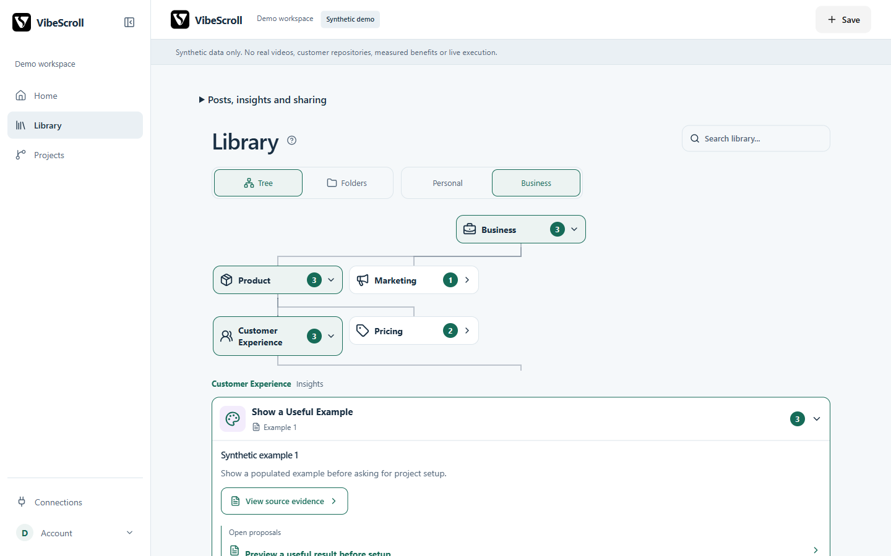
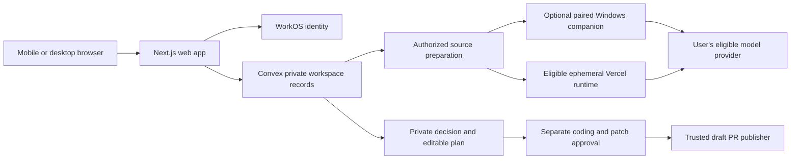

# VibeScroll

Make scrolling useful. Keep saved ideas with their source evidence, find them again and decide what belongs in your projects. Library-only use is a complete experience.

[Inspect an example](https://scroll.companynerve.com/example) · [Hosted app](https://scroll.companynerve.com/app) · [Help](https://scroll.companynerve.com/help) · [Personal setup](docs/PERSONAL-SETUP.md)

The example uses clearly labelled synthetic text. Its useful, already-implemented and no-fit decisions demonstrate the review process without claiming customer results. New routes in this branch need the separately approved release before appearing on the hosted site.

<picture>
  <source media="(prefers-color-scheme: dark)" srcset="apps/starter/public/product/library-dark-1440.png">
  
</picture>

Actual candidate UI with synthetic data. [40-second captioned overview](apps/starter/public/product/overview.mp4), [setup guide video](apps/starter/public/product/setup-walkthrough.mp4), [text transcripts](docs/launch-kit/media.md) and [mobile view](apps/starter/public/product/library-light-390.png). Live sign-in, pairing and a real sample run remain separate acceptance steps.

## What you can do

Save a permitted source → inspect cited insights → find and organize knowledge → optionally review project fit → retain an editable plan.

Coding, spending, patch approval and draft PR publication are separate decisions. A merge does not prove that an idea helped.

| Capability                                                                | State and limits                                                                                                                                                          |
| ------------------------------------------------------------------------- | ------------------------------------------------------------------------------------------------------------------------------------------------------------------------- |
| Browser library, search, Tree/Folders, filing, export/deletion            | Implemented. Current role, workspace and source permissions apply.                                                                                                        |
| Permitted URL, upload and supplied-text intake                            | Implemented with source-specific access failures. Importing saved links captures metadata, not completed analysis.                                                        |
| Cited extraction and selected-project review                              | Enabled routes vary by account, provider, quotas and reviewed funding. Sampled evidence is not exhaustive coverage or verified truth.                                     |
| Managed processing and isolated Vercel coding                             | Existing bounded routes require reservations, current eligibility and separate approvals. Do not infer general availability from the demo.                                |
| ChatGPT/Codex library access                                              | Private pilot through registered OAuth clients and explicit scopes. Connecting alone grants no library access.                                                            |
| Personal automatic analysis                                               | Supported Windows companion path with eligible own-account official client, offline transcription and isolated preparation. Independent setup acceptance remains pending. |
| General commercial hosted ChatGPT-plan inference                          | Externally gated. Never pool the founder's subscription or silently switch to API funding.                                                                                |
| Windows local coding                                                      | Blocked until its required isolation acceptance passes.                                                                                                                   |
| Public knowledge, reuse, discovery and direct GitHub/Reddit source intake | Follow current feature gates and exact-commit evidence. A local candidate or fixture is not a released live integration.                                                  |

See [capabilities](docs/CAPABILITIES.md), [readiness](docs/V1-READINESS.md) and [implementation evidence](docs/implementation-status.md). Independent usability, model quality, provider permission and production verification are separate evidence.

## Try the synthetic local demo

Use the verified Node 24.22.1 patch and pnpm 12.3.4. From a fresh clone:

```powershell
pnpm install --frozen-lockfile
node scripts/setup-preflight.mjs --demo
pnpm dev
```

Open localhost:3001/demo. Try Library, Tree/Folders, source evidence and Projects. The example at localhost:3001/example is readable without an account or JavaScript. Demo actions represent no provider work, payment or GitHub write.

Fixture states are available at /demo?uiState=empty, /demo?uiState=loading and /demo?uiState=error. No accounts are needed for this preview. Package installation needs registry access or a prepared offline store; the application is not distributed as a self-contained offline bundle.

## Hosted or your own copy

| Path                                       | You need                                                                                         | You operate                                                             |
| ------------------------------------------ | ------------------------------------------------------------------------------------------------ | ----------------------------------------------------------------------- |
| Hosted application                         | Browser, account and an available processing route                                               | Your permissions, selected budget and provider allowance                |
| Local synthetic demo                       | Node, pnpm and installed packages                                                                | Local development server only                                           |
| Your own metadata library                  | Your Convex and WorkOS environments, Google/email-code setup and Next.js                         | Credentials, deployment, costs, backups and recovery                    |
| Uploads and private frames                 | Private storage, encryption and scoped grants                                                    | Retention, access and deletion                                          |
| Personal analysis                          | Supported paired Windows computer, Docker images, offline ASR and your eligible official account | Worker readiness, provider quota and local protected credentials        |
| Project review or optional cloud execution | Your GitHub App, reviewed inference route and eligible isolated Vercel runtime                   | Selected access, reservations, checks and separate publication approval |

[Personal setup](docs/PERSONAL-SETUP.md) lists the actual dependencies. [Local development](docs/local-development.md) separates demo, account setup and integration verification. Open source does not make hosted providers free, grant content rights or remove commercial-access restrictions.

## How the pieces connect



Credentials stay in their protected server or local stores. Local preparation can send selected text and sampled frames to the model provider. Source material, repository files and model outputs cannot grant permissions.

## Use with an assistant

The private pilot MCP endpoint is https://scroll.companynerve.com/mcp. A host needs a registered OAuth client; the endpoint alone is insufficient. In Connections, review Personal/Business scope, permitted actions, optional project context and expiry. Current/future access and automatic processing require their own reviewed grant.

Retrieval uses get_profile, search with pagination, then fetch. Saving a link is different from analyzing it. Automatic local extraction needs the paired worker and a newly reviewed automatic-analysis grant. Once that grant is configured, submitted media links can queue without another per-link approval; using VibeScroll credits still requires an explicit choice. “Save only” remains available. Coding and publication retain separate approval.

[Assistant access](docs/operations/assistant-access.md) · [Local assistant worker](docs/operations/assistant-local-runner.md). Persistent completion Events remain disabled; a finished chat is not promised unsolicited completion messages.

## Security and privacy

- Media downloads use a platform-specific domain allowlist. The download broker rejects private network addresses and checks each new connection, including destinations reached through redirects.
- Local media retrieval and decoding run in isolated Docker workers with no direct network access or host folder mounts. A separate broker permits only approved HTTPS destinations. Processing has size, duration and resource limits.
- Assistant access follows the library scope and actions you choose in Connections. Access can be revoked there. Source content and model output cannot grant permissions.
- The local ChatGPT route keeps its saved login on your computer. Transcripts and sampled frames go to OpenAI for inference; derived insights and evidence are saved in your private VibeScroll library.
- Automatic extraction does not authorize paid fallback, coding or publication. Those actions retain their separate funding and approval boundaries.

See [security and privacy for users](docs/SECURITY-FOR-USERS.md) for the exact download domains, data flow, failure cases and evidence limits. [Private vulnerability reporting](SECURITY.md) and [technical security requirements](docs/SECURITY.md) have separate references. These protections do not establish an independent security audit.

## Contribute and follow progress

Read [CONTRIBUTING](CONTRIBUTING.md), [SECURITY](SECURITY.md), [community conduct](CODE_OF_CONDUCT.md) and the [documentation map](docs/README.md). Use synthetic reproductions and keep private content out of issues.

The [complete implementation plan](docs/launch-plan/2026-10-22/README.md) distinguishes engineering from live acceptance and release. [Versioning](docs/VERSIONING.md) binds immutable alpha releases to exact commits and CI. [Changelog](CHANGELOG.md) preserves historical release context. Stars are a discovery signal, not evidence of customer value.

V1 code uses [MIT](LICENSE), preserving [CompanyNerve and third-party notices](THIRD_PARTY_NOTICES.md). Hosting, managed processing and support are separate services. V2 remains a separate roadmap.
