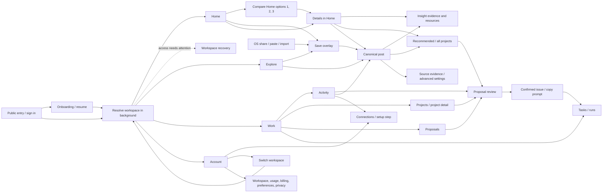

# VibeScroll app structure and implementation plan

R171–R172 design review · November 13, 2026 · Implementation authorized in R173

The [November 16 implementation and scores](APP-UI-REVIEW-2026-11-16.md) record the current Browse-only design and responsive website. The original screen proposals remain below for context.

The local review board is at `outputs/app-overview-2026-11-13/index.html` in this checkout. It includes mobile and desktop wireframes for 23 screen families and 158 selectable states, 29 image boards, and linked navigation paths. Review the entire screen or a specific state. Home and its detail panel record decisions separately for each option. The [route and interaction ledger](APP-SCREEN-AND-LOADING-LEDGER.md) tracks each website route, critical overlay, and loading treatment. The [production comparison plan](HOME-COMPARISON-AND-WORKSPACE-ENTRY.md) defines the three Home options, workspace navigation, and release checks. These documents are the handoff for the next design review. See the [implementation and review](WEBSITE-REDESIGN-REVIEW.md) for the verified checkpoint and remaining coverage.

## Decisions to review

| Decision | Proposed default | Approval |
| --- | --- | --- |
| Home | All three options ship to production together on phone and desktop for the owner's comparison. Keep the final default open. | Scope set by R172. Design review pending |
| Explore | One saved library with Posts, List/Tree/Folders, and ranked post and insight search | Pending |
| Work | Activity, Projects, Proposals, Tasks. Open Activity from Work's unread indicator, remember the last Work view otherwise | Pending |
| Workspace | Resolve it automatically on ordinary entry. Keep switching under Account and a recovery view for users without a readable default. Preserve the same app layout across workspaces. | Recommended for review |
| Profile | Private account landing page with connections, preferences and account actions | Pending |
| Style and motion | Compact navigation, no persistent wordmark in the signed-in core, shared post reader, and explicit controls for gestures | Pending |

## Page map

### Entry, Home, Explore, and Save

| Screen | Route or entry | Contents and exits | Review states |
| --- | --- | --- | --- |
| Public and sign-in | `/`, existing sign-in, `/example`, `/demo`, `/help`, `/docs` | Existing product content, bounded example, account entry and help | Signed out, callback, sign-in failure, expired session, safe return |
| Onboarding | `/onboarding`, `/onboarding/resume`, `/onboarding/project` | Interest quiz, saved-post benefit, Instagram import guidance, ready example, account, optional GitHub, existing Pro/credit steps, assistant setup or Connect later, Home | New, importing, no match, example ready, draft resume, checkout pending/cancelled, existing-account bypass |
| Workspace resolution | `/app`, Account switcher, `/app/workspaces`, `/join/[token]` | Resolve the default behind the app shell. Use the switcher on request. Use the recovery/manage route when needed. Return to the intended post, draft, or setup step when permitted | Personal default, multi-workspace, no access, invite pending/expired, switching |
| Home | `/app/[org]` | Saved ready posts. Show one author, title, media and category group per post. Heart and named details entry. All three options use the same post, insight, project and proposal data | Loading, ready, text-only, carousel, poster-only, empty, exhausted, unavailable, offline |
| Home details | In-place state on Home | Insights, recommended projects, all projects, proposals, Open full post. Both insights and project actions reachable here | Closed, open, insight expanded, no frames, no projects, no matches, no proposal, draft/active, restoring |
| Explore / Posts | Proposed canonical list `/app/[org]/posts`. Current `/library` supplies ranked search and Tree/Folders | One Explore destination. Browse List, Tree, Folders. Search post and insight results, with removable filters for authorized status, category and proposed platform. Default recently added, retain meaningful existing sorts. Use relevance in search. Mobile sheets, desktop popovers | Unfiltered, filtering, active chips, sorting, no results, processing, stale cursor, index catching up, error |
| Full post | `/app/[org]/posts/[id]`, legacy `/library/[id]` compatibility | Same reading sequence as Home. Add original source, transcript, frames, and analysis/version controls at bottom. Insight results can open the matching version and insight after authorization | Ready, awaiting analysis, processing, known failure, unknown, previous/stale version, withdrawn, evidence missing |
| Save | Global action, `/share` continuation and supported import/upload entry | Paste link, save-only or eligible analysis, consent/settings where needed, retained result and next action. Show valid duplicate as Open saved post. Keep draft and return focus on close | Invalid, duplicate, saved, queued, waiting for assistant, credit/setup block, failed, unknown |
| Library extras | `/shared`, `/catalog`, `/catalog/[id]`, `/trends` under the workspace | Scoped shared items and eligible catalog browsing from Explore. Trends only shows supported analytics | Access off, paywall/setup, shared access removed, no data, populated |

### Work and Account

| Screen | Route or entry | Contents and exits | Review states |
| --- | --- | --- | --- |
| Activity | Current `/app/[org]/inbox`, proposed Work → Activity | All / Proposals / Posts / Integrations, new and earlier, unread, one contextual action. Opens exact proposal, post or setup step | Caught up, filtered empty, unread, proposal ready, integration action, status unknown, target unavailable |
| Projects | `/app/[org]/projects`, legacy `/repos` | Actual projects, permission-aware actions, Connect project, current proposal and task context | None, connected, permissions needed, context changed, read-only |
| Project setup and detail | `/projects/new`, `/projects/[id]` | GitHub selection, project context review, confirmed repository, linked proposals and tasks | Unconnected, no repositories, context loading, review, connected, denied/revoked |
| Proposals | `/app/[org]/proposals`, legacy `/plans` | Filter by project and review state, open stable proposal | None, draft, generating, ready, deferred, rejected, stale, failed |
| Proposal review | `/app/[org]/proposals/[id]` and the same review inside Home or Work | Title, project, cited insights, plan, discussion, quote when applicable, and exact-version Approve & create issue. On confirmed write show Open issue and Copy work prompt | Quote, draft, queued, ready, edited, stale, read-only, GitHub setup needed, publishing, unknown, confirmed, failed |
| Tasks and improvements | `/runs`, `/improvements` under the workspace | Durable task and issue/PR handoff status, linked proposal, checks and feedback where available | None, queued, running, blocked, unknown, failed, completed, issue open/closed, PR state |
| Profile | `/app/[org]/account`, existing global `/account` for account management | Identity/avatar, default workspace context, connections, credits, billing, appearance, notifications, privacy, help, sign out | Normal, avatar fallback, read-only workspace, switching, session expired |
| Connections and computers | `/connections`, `/runners`, existing `/connect` and `/setup` entry points | GitHub and assistant setup, exact status and next step, grant management, optional paired computer | Not connected, connecting, ready, action needed, revoked, incompatible, unavailable |
| Usage and billing | `/usage`, `/billing`, `/billing/change/[id]` | Real credits and reservations, usage history, plan, checkout, supported change and invoice actions | Loading, no activity, finite balance, pending hold, low balance, paid, checkout pending/cancelled, failed |
| Appearance and notifications | Account subviews | System/light/dark, interface motion, browser notification permission when supported. Work Activity stays discoverable | System or override, reduced motion, unsupported, denied, granted, partial delivery |
| Privacy and workspace settings | `/privacy`, `/settings`, `/team`, global account export/delete | Workspace access, invites, ownership, export, cookie preferences, deletion and confirmation | Member/owner/viewer, invite expired, export ready, ownership blocker, confirmation, deleted |
| Operator and public supporting pages | `/audit`, `/launch-checks`, `/app/moderation`, `/account/invoices`, public discover/collections/recipes/editions/open-source/topic pages | Keep existing role gates and public navigation. Review presentation separately from product behavior | Forbidden, empty, filtered, failure, ready |

### Navigation, URLs, and state

- Phone uses Home, Explore, Save, Work, Account in a 48px app bar plus safe area, with a small inline Save plus. Desktop keeps a slim rail and the same order. Keep 44px touch targets as the product target and preserve focus and browser zoom.
- Use stable canonical post and proposal IDs. Initially render existing legacy URLs through the same reader and test incoming MCP, search, proposal, and share links before any redirect. Preserve authorized version/insight intent and whitelisted filters. Keep legacy plans, repo, and inbox links working while review decides final labels.
- Use query parameters for committed search/filter/sort and a stable insight target where it is shareable. Keep transient drawer focus, press state, scroll offsets and drafts out of the URL. Browser Back closes a route-backed overlay or returns to its originating item. A direct link has a safe list fallback.
- Restore Explore query and result focus, Home post and panel position, and Work Activity filter and selected row. After a workspace switch, restore within the new scope only. Recheck access before replaying a continuation.
- Keep metadata-first paging and bounded detail cache. Fetch current detail plus small neighbor metadata. Load visible frame thumbnails and fetch heavier source evidence on demand. Support explicit pagination when filters yield short pages and a valid cursor. Keep known failures separate from unknown writes.

## Three Home concepts

| Option | Touch flow | Desktop and fallback | Decision test |
| --- | --- | --- | --- |
| 1. Like or pass | Swipe right to like and left to pass. Scroll down to read the current post. An intentional vote can advance the review queue. Undo restores the prior item and vote | Visible Pass / Like and View insights; keyboard equivalents; remain within the current saved library | Quick triage. Check whether users understand Pass, reach evidence before voting, and recover accidental votes |
| 2. Browse and open | Vertical browse. A right swipe from inside the post, or View insights / View projects, opens the requested section in place | Click or keyboard opens the same detail and Back restores feed position. Browser edges, video controls, and thumbnail strip keep native behavior | Compare time to find one insight and open one project. Confirm gesture discoverability and usable dense reading |
| 3. Full-screen snap | Swipe up for next and down for previous. On release settle one post when appropriate; small drags return. Insights lifts and proportionally shrinks the same media, panel scrolls beneath it | Scroll/trackpad and explicit previous/next controls; focus-aware keys. Close restores same post, scroll, and media position when supported | Check snap intent, open/close reversals, media continuity, text-only sources, and scroll isolation in the panel |

Compare all three against the same starting order, post content and available actions. Run the production comparison after release acceptance. Ask the reviewer to find the Shader Gradient insight, open all projects, draft a proposal, return to the same post, and move back one post. Record accidental switches, state loss, and which route they expected. Option 3 is the provisional first option for the comparison. The owner selects the permanent default after trying all three.

## Mobile interaction and motion

| Interaction | Proposal | Acceptance |
| --- | --- | --- |
| Touch targets and hierarchy | Fitts's law suggests making frequent controls easy to hit. Aim for 44×44 CSS px hit areas even with smaller icons. Hick's law suggests one clear next action, with advanced controls below the reading flow | Test at 320/390 CSS px, keyboard and safe area, with no clipped labels at 200% text zoom |
| Familiar controls | Use recognizable labels, visible chevrons, a labeled heart, and Close for sheets. Similar rows use consistent behavior cues | A first-time reviewer completes the journey without discovering a gesture |
| Double tap | In Options 2/3, double tap on non-control post media can set Like once. Single tap on the explicit play control stays playback. Repeated double taps keep Like set. The heart toggles and shows state | No accidental vote on scroll, text selection, buttons or browser gestures; preserve pinch zoom and offer preference off if device behavior conflicts |
| Swipes and scroll | Lock direction after intent. Avoid screen edges. The full-screen feed owns vertical movement only when closed. The open panel owns vertical scroll; the insight strip owns horizontal scroll. Drag-to-dismiss from handle with a Close equivalent | First/last, short/fast, diagonal, keyboard, pointer cancel, reversed animation, nested scroll, and native browser Back |
| Response to input | Small press feedback around 100–140 ms, selection or expansion 150–200 ms, panel lift around 220–280 ms, tuned from device tests. Use transforms/opacity and interruptible gestures. Skip ornamental motion for rapid or keyboard-driven actions | Reduced motion uses the same state change immediately. No focus displacement or repeated flashing. Opening then immediately closing restores exact geometry |
| Feedback | Keep Like subtle, use one quiet confirmation for a saved post or confirmed issue, and respect system/browser support for optional haptics. Skeletons reserve space and observed job stages use real status | Unknown is never rendered as completed. No fake completion percentages, forced animation, constant CTA shimmer, or required haptics |
| Theme and content | Use current product typography, charcoal surfaces and mint accent with equivalent light tokens. Keep evidence images in their original colors. Lean on spacing, focus, and hairlines | Light/dark/system plus long names, missing images, readable contrast, voice labels, and media fallbacks |

Keyboard and single-pointer equivalents for drag use the WCAG guidance. Gestures and motion follow familiar behavior and avoid competing with the system. Screen structure uses visible system status, recognition, and reversible actions. [W3C dragging movements](https://www.w3.org/WAI/WCAG22/Understanding/dragging-movements), [W3C target size](https://www.w3.org/WAI/WCAG22/Understanding/target-size-minimum), [Apple gestures](https://developer.apple.com/design/human-interface-guidelines/gestures), [Apple motion](https://developer.apple.com/design/human-interface-guidelines/motion), [Nielsen Norman Group heuristics](https://www.nngroup.com/articles/ten-usability-heuristics/).

## Saved VibeScroll research

Search used the signed-in workspace. The connector rejected its advertised explicit mode argument. Its accepted default returned ranked results, some lexical-only. I read the retained post analyses for the examples below and used snippets where indicated. This is a targeted sample.

- **Six more laws. Every screen.** Its saved analysis illustrates input normalization, moving predictable choices into the system, and consistent cues for tappable rows. Apply those to URL paste, workspace defaults, and Profile/Activity rows. Keep the saved video's numeric examples out of the design claims. [Saved post](https://scroll.companynerve.com/app/nn7d15ckc9p6xsx0z7sd09w7298fey3s/posts/px7b61qm4xcjhvdkew83pzkybn8feq00)
- **Arc UI.** The saved analysis shows removable filter chips, a sortable table, a chronological timeline and a finger-following sheet. Use the interaction patterns for Explore, Activity, and the Home panel. [Saved post](https://scroll.companynerve.com/app/nn7d15ckc9p6xsx0z7sd09w7298fey3s/posts/px77sxck1kg680jx5crhj1xt2n8g2n94)
- **Nessie motion notes.** Its saved analysis describes short press feedback, skeletons and reduced-motion handling. Apply that restraint to the feed and proposal states, with visible status carrying the meaning. [Saved post](https://scroll.companynerve.com/app/nn7d15ckc9p6xsx0z7sd09w7298fey3s/posts/px76mwh8n60et1ghnz2ngm9zx98g3kg0)
- **Cindy Zhu's web effects Reel.** Retained visual citations support the Liquid Glass JS README and Shader Gradient editor cards. Speech-only references use transcript or a clearly marked nearby frame. [Saved post](https://scroll.companynerve.com/app/nn7d15ckc9p6xsx0z7sd09w7298fey3s/posts/px76tv3zvwrykfv6mx3p40zhz98j4b6a)
- **Mobile Native and Knowunity.** Search snippets illustrate touch focus and asking for notifications after communicating the value. Keep browser permission user-initiated and put real in-app events first. The Knowunity full read returned an internal error. [Mobile Native post](https://scroll.companynerve.com/app/nn7d15ckc9p6xsx0z7sd09w7298fey3s/posts/px7d90v9xy48mpc9cz9p4j3ssx8h8e9b), [Knowunity post](https://scroll.companynerve.com/app/nn7d15ckc9p6xsx0z7sd09w7298fey3s/posts/px76cza844453q1yk71trtqcq58hyjyg)

## Implementation sequence after approval

| Phase | Build | Verify before proceeding |
| --- | --- | --- |
| 0. Approve flows | Review each page and state. Set the provisional Home launch choice, review access and gesture rules. Record the pending permanent decision. | Save exported decisions and selected reference boards. Check the route and interaction ledger against both web applications. |
| 1. Shared website navigation | Compact nav, rail, direct scoped links, fast default workspace lookup, route-local loading, back/scroll restoration, shared theme, focus and motion behavior | Direct, back and refresh paths across personal, team and viewer roles. No routine workspace interstitial. Check 320/390/768/1440, both themes and keyboard. |
| 2. One reader and Explore | Reuse retained source and proposal reads. Unify Home/full-post presentation. Add evidence-first cards and resource provenance. Move source settings to bottom. Wire library search, filters, pagination and canonical aliases | Same version and IDs from every entry, real decoded frames, authorization loss, text and poster fallbacks, search filter/cursor and link preservation |
| 3. Three production Home options | Build Like/Pass, Browse and open, and Full-screen snap over the same reader. Implement the mode selector, continuation across modes, and reversible likes/pass behavior. | Verify all three on touch, trackpad and keyboard. Check media continuity, drafts, existing likes, loaded neighbors, scope and parity of actions. |
| 4. Work and proposal loop | Integrate existing exact-version plan/discussion and issue flow. Project choices remain visible even with no proposals. Add Activity typed events and scoped read state incrementally | Current proposal from Home, Work and deep link. Verify dedupe, unread, exact integration resume, race, revocation and ambiguous provider result |
| 5. Account, Save and entry | Update approved layouts around current auth, onboarding, share/import, billing and privacy flows. Preserve resumable drafts, balances, and distinct processing stages | Approved onboarding paths, repeat saves, failures, checkout handoffs, owner/viewer rights, connection recovery and data export/delete affordances |
| 6. Finish public, support and restricted screens | Apply shared visual rules with the appropriate public or authenticated shell. Walk every route in the ledger and record exceptions with evidence. | Check public links, metadata and handoffs, legal layout and text, role-gated routes, fallback UI, both themes and breakpoints. |
| 7. Release and compare | Release all three Home options together once approved, and deliver the website in verified slices. Run relevant lint/type/build, focused regressions and interaction checks. Use exact candidates and existing funding limits. | Stage all three and verify real authorization, provider receipts and production availability. Record the owner's final choice after comparison. |

The plan proposes website UX and interaction changes. The review board has static design states and working local review controls. Actual gesture physics, accessibility, backend event delivery, costs, and route performance require implementation verification. The image comparison puts Explore in the middle concept and some rendered sample thumbnails/authors and nav controls drift. The wireframes and this plan carry the intended content and routing.

The local board rendered every state in Chrome. Screen and image links resolved, the three-option controls could change posts and restore them, and screen-level and state-level notes persisted. The checked layouts fit 320, 390, and 1440 CSS px.
