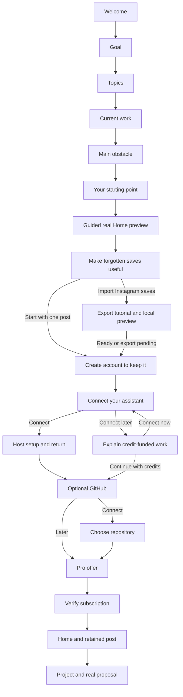

# Onboarding V1 and V2 review

Status: V1 approved for implementation under R151, November 2, 2026. V2 remains deferred. R151 authorizes this V1 implementation and routine publication within the standing limits. No inference, payment or price change is part of this checkpoint. Website/backend189dc4f are live under the [R151 acceptance receipt](../operations/evidence/launch-20261102-focused-onboarding.json).

## What simpler means

Simplify each screen, not the number of useful screens. Give each page one question or one small teaching moment, one primary action and a useful Back action. Keep the quiz. Show recommended posts directly in the real Home layout rather than a separate selection gallery. V1 has no mascot. V2 may add an optional mascot.

Recommend an experience-first sequence: explain the outcome, ask relevant questions, show one complete real result, create the account, offer assistant and GitHub setup, then present Pro and continue the real workflow. The owner approved connecting MCP later. It must not block entry. Assistant setup is a core onboarding step, not an advanced setting or a prerequisite for credit-funded work.

The proposal uses four short quiz screens. Every answer changes recommendations or guidance. These are useful decisions, not a target number to maximize. There is no invented completion-time promise. Optional branches appear only when relevant.

## Forgotten posts, useful ideas and input methods

R150 corrects the positioning inferred under R149: sending a link is an input method, not the emotional promise. Lead with useful posts that people save, forget and never apply. Introduce a dedicated benefit screen immediately before the Instagram saved-post import screen/tutorial. Users can still start with one link or the ready example; an existing saved collection is not required.

Saving a useful post does not make it useful later. Good advice gets buried, its lesson is forgotten, and it never reaches the projects where it could help. VibeScroll brings those posts back as findable ideas and helps people decide how to apply them across their work. This is proposed positioning, not a guarantee that every saved post is available, useful or relevant to every project.

Show the benefit in ordinary language: **Rediscover forgotten posts → Find the useful ideas → Put them to work in your projects.** Then explain the two inputs: import earlier saves or send a new link. The post and result remain available in VibeScroll afterward. Project application is optional; learning, discussing and finding an idea later are valid outcomes.

For connected users, sending can start in their supported assistant chat. Other users paste the link in VibeScroll and use the current quoted credit route. Ordinary MCP connection alone does not make every host chat an automatic media worker. Show actual source availability, processing progress and result status. The ready onboarding example demonstrates the retained result, not a promise that every fresh link is instant.

### Explain words when they first matter

| Word                        | Plain explanation in the relevant screen                                                                                                                                            |
| --------------------------- | ----------------------------------------------------------------------------------------------------------------------------------------------------------------------------------- |
| Post                        | The original video or social post brought in through an import or a link. A prior platform save is not required for direct link entry.                                              |
| Analysis                    | VibeScroll processes the available content to identify useful ideas and their context. Actual missing content stays disclosed.                                                      |
| Insight                     | A useful idea, lesson or takeaway from the post. Explain beside the first real insight rather than showing a glossary first.                                                        |
| Project                     | Something you are working on, such as a product, business or codebase. A GitHub repository is one way to supply its context.                                                        |
| Proposal or plan            | A draft of how the post's ideas could help your project. It can be discussed and edited; creating it does not change code. Prefer Plan in introductory copy.                        |
| Library                     | The posts and ideas brought into VibeScroll through requested links, selected imports or deliberate sharing, so they can be found again.                                            |
| Assistant connection or MCP | The connection that lets a supported assistant retrieve your authorized VibeScroll data and save supported work back. Say Connect your assistant first; MCP is explanatory detail.  |
| Credits                     | Your VibeScroll allowance for the processing and in-app AI work shown in a quote. Assistant reasoning may use its own allowance; some preparation can still use VibeScroll credits. |
| Ready result                | A compatible analysis already exists, so it can be reused under the current access policy. Keep Cache as secondary terminology.                                                     |

Do not teach every word on a single page. Pair a short explanation with the action or real object it describes. Consistent terms and small graphics should explain the product without adding a manual to the quiz.

## Research and direction

The [research notes](ONBOARDING-RESEARCH-2026-11-02.md) record bounded live VibeScroll searches, exact Exponential source and external examples. The onboarding query returned 60 indexed matches across 25 distinct accessible posts after continuation to exhaustion. Quiz, activation and paywall searches supplied additional context. This is relevant-index research, not a claim that every stored transcript was scanned or that semantic search exists. The separately granted catalog has no ready search projection and did not add an independently searchable corpus.

The common useful ideas are visible personalization, small decisions, a real first win before pricing, setup explained by its benefit and help during the actual task. These are hypotheses. Conversion percentages in saved social posts are not measured VibeScroll outcomes. Fake preparation waits, forced theme changes, aggressive button pulsing, free trials and manipulative reminders are not adopted.

Three structures were considered. A search-first entry loses the requested quiz. A setup-first flow asks for accounts and integrations before showing value. The recommended quiz-to-Home flow preserves personalization, proves the product and reuses the application. Keep account creation before payment so setup and purchase have a recoverable owner.

## V1 sequence

Quiz progress describes only the quiz. Do not show a false total across optional provider, payment and proposal branches. Subsequent screens use a short phase name or no progress label. Existing paid users skip completed onboarding. Unpaid returning accounts resume the last actionable step with post, connections and checkout state preserved.

## Screen 1: The promise

**Headline:** Make your forgotten posts useful again.

**Pain and solution:** You saved it because it could help. Then it got buried. VibeScroll brings back the useful ideas and helps you apply them to the things you are building.

Show a compact graphic starting with a buried collection of posts, then one rediscovered useful idea connected to project cards. Briefly show Import saved posts and Add a link as ways in. Use short captions: Find it again; Understand the idea; Put it to work. The relationship must remain understandable without animation. Use existing typography, source-card shapes and green accents. Illustrate the workflow without inventing a generated plan, live metrics or a completed analysis. Review artifacts identify illustrations; the user flow does not need a large synthetic-content banner.

**Primary:** Get started. **Secondary:** Sign in. Keep pricing discoverable through a quiet link. No email field, carousel, menu, mascot or autoplaying audio. The graphic makes one short transition and rests; reduced motion uses its static final arrangement. Do not imply a saved-post collection, import or GitHub account is needed to begin.

## Screen 2: Desired outcome

**Question:** What would you like to do with your ideas?

Four visible illustrated choices: Build something new; Improve my product; Grow my business; Learn and explore. Each has one short description. Select one, then Continue. Do not advance on selection. One benefit line explains that the answer determines the first posts and suggested action.

Learning emphasizes reading and keeping ideas. Build/improve emphasizes applying to a project. Growth favors marketing/business categories. The answer does not change entitlements or promise project suitability.

## Screen 3: Interests

**Question:** What would you like to see more of?

Use a searchable grid from the actual taxonomy: Building software; AI and tools; Product and design; Growth and marketing; Running a business; Video and content. Map groups explicitly to category IDs. Allow several choices and I am exploring. Selection uses shape and color, not color alone.

The answer narrows eligible recommendations and ordinary feed preferences. Search filters topics here, not a second post picker. No arbitrary minimum number of topics. Missing matches produce an honest broader suggestion, not fabricated personalization.

## Screen 4: Current work

**Question:** What are you working on right now?

Choices: An existing project; A new idea; A project with my team; Just exploring. An existing project can have an optional one-line name/description. GitHub comes later; no repository credentials here. Team selection creates no seat, invite or community automatically.

The answer determines whether project setup is prominent and which first action follows. Exploration never forces a repository. Context influences suggestions only after the user supplies or authorizes it. Explain each-member Pro at the actual invitation step, not in dense quiz copy.

## Screen 5: Main obstacle

**Question:** Where do good ideas usually get stuck?

Choices: I lose useful links; I forget the useful advice; I struggle to apply it; I find more ideas than I can use. Not sure is valid. These choices cover people sending individual links as well as those importing earlier saves.

This changes the first help: Keep and revisit, search/categories, project application, or focused recommendations. A small relevant diagram changes with selection. No diagnosis, invented improvement percentage or unrelated demographic question. If implementation cannot make this answer affect guidance, remove this question after review instead of collecting unused data.

## Screen 6: Their starting point

**Headline:** A starting point for your ideas.

Show a compact visual summary of actual answers: topics, goal and the practical next action. Explain the app with three short steps: Bring in a post; Find useful ideas; Apply them to your work. Briefly show that the post and ideas stay available in VibeScroll. Highlight the relevant step based on the obstacle. Answers remain editable without losing independent later progress.

**Primary:** Show me how it works. This deterministic summary is not an AI project plan. Open the real Home preview, not a separate picker. Selecting recommendations can show a real skeleton while fetching. No timed fake spinner, typed-out explanation or claim that a model is thinking. Continue immediately when ready.

## Screen 7: The real Home preview

Open the first relevant eligible post directly in the existing Home feed. No intermediate gallery. Reuse thumbnail/creator/categories, insight expansion, settings panel and desktop columns/mobile sequence. Preserve the selected four Home design references. On phones, content leads without a repeated large header.

A dismissible cue points first to expanding an actual insight, then to applying the post to a project. Keep one cue visible. Users may scroll without a long mandatory tour. Search and metadata browsing remain bounded to the authorized starter selection. Preserve the one-complete-result preview: the chosen result may be reopened; another full result needs account/Pro. Sharing UI does not expose the full catalog.

At first expansion, explain Insight as a useful takeaway from the post. At the project action, explain that a Project is their product, business or codebase and a Plan is a draft of what to do with the idea. Use the real current post to teach these relationships. Avoid introducing analysis, evidence, proposal, repository, catalog and MCP together in the opening screen.

**Next action:** Keep this post. **Contextual action:** Use for my project. Both preserve the post and next action through signup. Guests see account-required actions instead of fake likes, fit scores or successful writes. Counts must come from allowed data; omit unknown counts. Evidence stays on demand. Use the retained poster and Open original if playback is unavailable.

An own link remains available: Have a link in mind? Retain its normalized intent for after access and explain that fresh analysis needs a quote. It is not instantly analyzed. Continue into the saved-post benefit screen before offering Instagram import instructions. Reading the guide or previewing a selected local export does not start account-level import or analysis.

### Screen 7a: Make forgotten saves useful

Place this benefit screen immediately before the Instagram import screen/tutorial. It follows the real Home preview so the promise has a concrete example behind it.

**Headline:** You saved them for a reason.

**Copy:** Good ideas get buried in your saved posts. Bring them into VibeScroll to rediscover the useful advice and see where it could help your projects.

Show a saved-post stack becoming insight cards, with one idea connecting to several project cards. Explain reuse across projects, not that every post fits every project or that plans already exist. Reuse retained post/evidence data; project-specific plans remain separate reviewed work with their normal quote.

**Primary:** Import my Instagram saves. **Secondary:** Start with one post. The secondary path keeps the example or pending own link and continues to signup. No mascot, guilt message, invented count of forgotten saves or promise that everything is automatically analyzed.

### Screen 7b: Instagram import screen and tutorial

**Headline:** Bring your Instagram saves into VibeScroll.

Explain the outcome first: choose a Saved export, review its post links and select what to bring in. Two visible paths are Get my Instagram export and I already have a file. Keep the tutorial visual and stepwise using verified current provider instructions. Guide the user to export only Saved information, All time and JSON where supported. Verify actual platform labels/screens before publishing new tutorial assets.

Explain that Instagram may take time to prepare an export. Continue with this example preserves the reminder and returns to signup without losing progress. No Instagram password, cookie or full private account archive is required. Users can return to the guide later from Home/Connections help.

### Screen 7c: Local file preview, when a file is ready

Reuse the existing device-local ZIP/JSON/HTML preview. Show actual valid links, duplicates and unsupported entries. Selecting a local file does not upload the full archive or process every video. Explain that selected account saves follow the normal account/access step and new analysis requires its current quote. Compatible ready results can be reused under the normal policy.

Retain only the safe draft/reminder and acknowledged selections allowed by the existing contract. A missing File after reload requires reselection; do not claim it is still available. Do not store a giant archive in localStorage. This preview remains optional and never blocks the ready Home example.

## Screen 8: Save progress with an account

**Headline:** Keep your links and ideas together.

Show the selected real post compactly and existing WorkOS sign-in choices. Ask only for identity-provider requirements. Explain that setup and Pro follow; hosted payment is not a surprise.

Preserve answers, post, Apply intent and local import reminder through sign-in. Signup does not charge credits, process media, publish or grant paid access. Existing sign-in resumes safely without resetting a workspace or forcing the quiz again.

## Screen 9: Connect an assistant

**Headline:** Send links and use their ideas in your assistant.

ChatGPT is the primary connection action. Codex is another supported MCP client with concise instructions, not a dropdown. Benefit: Send supported links, retrieve their useful ideas, discuss them and save project plans from your assistant. Explain that MCP is the connection used for this, not an extra AI subscription sold by VibeScroll. The quieter action is Connect later.

Reuse the current guide and official authorization. Do not promise one-click install where the provider requires manual setup. Reuse valid grants, remove duplicate scope pickers and preserve explicit off/narrowed access. Default access includes authorized personal/joined-team collections under current policy.

Linked authentication and actual tool access are separate observations. Before payment, complete supported OAuth/setup where possible; a paid-only read waits for entitlement. After access, perform one bounded read-only readiness check. An empty library is valid. No test analysis, credit spend, credential paste, five-minute reauthentication or second MCP app.

After verified connection, automatically prefer the assistant for supported assistant work. No extra Enable MCP checkbox. Display observed capabilities only. Ordinary MCP connection does not prove Events readiness, wake an unattended chat or allow arbitrary server requests to consume a subscription. In-app credit work remains available with its quote. Reuse an already-ready Events monitor; otherwise offer its separate setup when background analysis is requested.

### Screen 9a: Host setup and return

Show actual host instructions and Open client/Copy server URL where supported, I have connected, and Connect later. A longer guide can expand in place. Distinguish Opening, Waiting for return, Authentication linked, Check needed and Ready. External return restores the step. Provider revocation needs a normal reconnect, not a new quiz.

If a host plan/workspace cannot add custom MCP servers, offer the other supported client or credits. Do not strand users or claim every ChatGPT account supports identical setup.

## Screen 10: The connect-later explanation

Only show this page after Connect later.

**Headline:** You can start with VibeScroll credits.

**Proposed copy:** VibeScroll can analyze posts and create plans inside the app using your included credits. Connect an assistant later to search and discuss saved insights, and draft plans in your own chat. That work uses your assistant's allowance. Video preparation and work you run inside VibeScroll may still use credits.

Use a two-lane diagram: VibeScroll app → credits; connected assistant → assistant allowance, with a shared preparation step where applicable. No unsupported savings percentage. Do not say MCP unlocks every feature or that disconnected users lose normal app features.

**Primary:** Continue with credits. **Secondary:** Connect my assistant. This is explanation, not another purchase or punitive confirmation. Remember the decision; no repetition on every login. Later quotes itemize preparation and analysis. Compatible ready results remain zero-credit under current policy.

## Screen 11: Optional GitHub

**Headline:** Make these ideas useful for your project.

A small diagram links the post to a project plan. **Primary:** Connect GitHub. **Secondary:** Do this later. Emphasize for build/improve goals, keep unobtrusive for exploration. Repository access supplies context; it does not approve code changes or issue publication.

Reuse existing authorization and return to onboarding. Already connected goes directly to repository choice. Failure preserves progress and permits retry/skip.

### Screen 11a: Repository

Reuse the tested searchable visible list, exact identities and private/public indication. Select one and Continue. Refresh/install access only when needed. Do not start repository snapshots or paid profiles before payment. A sole already-confirmed project needs its name and Continue, not a redundant picker.

A description can support a draft after access if GitHub is skipped. It cannot imply code was inspected or enable GitHub publication.

## Screen 12: Pro

**Headline:** Keep ideas moving with Pro.

Reuse visible payment choices: EUR 35/month with 300 credits; EUR 350/year with 300 credits granted monthly; EUR 17/week with 75 credits. Suggest monthly initially; an explicit saved choice wins. Show annual billed total and weekly renewal. No free-trial promise, preselected purchase consent, invented countdown or hidden renewal amount.

Summarize only useful completed setup and the post. Explain credits and zero-credit compatible cache reuse with a concise detail link. Current top-ups remain EUR 17/200 and EUR 35/500. This does not sell/include the full-library add-on or advertise storage capacity.

**Primary:** Continue to secure checkout. Keep Back, sign out and recovery reachable. Cancellation/failure restores all selections. The server's verified price and wallet policy remain authoritative.

## Screen 13: Activation

Show actual subscription state. Pending verification explains the wait and reconciles the existing checkout; it does not create another purchase. No redirect-query-only unlock. Confirm access through current provider-bound entitlement/wallet checks.

Attach the chosen cached post and adopt the draft once, restoring the workspace/Home position. Do not grant the whole recommended feed or debit the cache association. Replays cannot duplicate charges/grants/saves. One short success acknowledgment leads to the actual next action, without a separate celebration detour.

## Screen 14: Home and the first useful action

Return to the same Home reader and saved intent. A dismissible checklist in the existing help panel can show Keep an insight; Apply to a project; Create a plan. Mark observed achievements only. Restore insight expansion and scroll position.

Exploration can continue through authorized saved posts. Public curation does not silently become paid full-catalog browsing. A new account retains its selected result and can explicitly request another curated post, save an own link or import. Never expose private global results as starter recommendations.

Connected users get a supported Open in assistant action or accurate instructions. Other users can connect from Connections/contextual help without replaying onboarding. In-app analysis keeps its quoted credit route unless a different supported executor is ready and chosen.

When showing the next link action, say Send another link or Paste a link. Import saved posts is an optional secondary action. Explain that their Library is where VibeScroll keeps requested posts and insights so they can return later; it does not require maintaining a saved list on the original social platform.

## Screen 15: First proposal, in the actual workflow

Continue within existing project/proposal UI, not another wizard. After access, prepare authorized project context, show actual readiness and its normal confirmation. Quote new credit-funded work. Use all insights from the exact post version and reuse retained evidence.

For assistant-authored plans, use the supported chat to retrieve context and save a durable proposal through MCP. An API button does not become subscription-funded because a grant exists. The same proposal appears in Home with existing discussion/refinement.

Show real queued/working/validating/ready/failure states. A ready version can be discussed/edited and published once through Approve & create issue. Request GitHub here if skipped. Signup, connecting and tutorial completion never approve publication. After confirmed creation, show Open issue and Copy work prompt.

## Branches and recovery

| Situation                              | Expected behavior                                                                                                                                                                                              |
| -------------------------------------- | -------------------------------------------------------------------------------------------------------------------------------------------------------------------------------------------------------------- |
| Existing paid/completed user           | Open workspace/Home. No repeated quiz or payment.                                                                                                                                                              |
| Partial anonymous quiz                 | Restore valid answers and visited-step history. Back preserves independent later answers.                                                                                                                      |
| Returning unpaid account               | Resume stored setup/paywall and post. Do not recreate integrations.                                                                                                                                            |
| Team invitation                        | Preserve exact destination, ask only missing personal setup, verify membership and each member's Pro/credits. No automatic personal-save sharing.                                                              |
| Exploring/no project                   | Reading/keeping first. Project/GitHub optional.                                                                                                                                                                |
| No ready match                         | Disclose a broader eligible suggestion; allow topic edits. No invented relevance or unquoted work.                                                                                                             |
| Image/preview unavailable              | Preserve position; retry/allowed poster/original. Preserve preview allowance and distinguish a fetch failure from a consumed full preview.                                                                     |
| Second full preview                    | Continue to account/Pro with first result retained. Shared UI cannot bypass the allowance.                                                                                                                     |
| Own link before access                 | Retain normalized intent; fresh processing follows access and quote. No job now.                                                                                                                               |
| Import wanted                          | Show the forgotten-saves benefit screen, then the Instagram tutorial/local preview; continue the ready result while an export is pending. No social passwords/full-archive upload or bulk analysis by default. |
| Connect later                          | One-time credit explanation, remembered choice, normal continuation.                                                                                                                                           |
| Existing MCP                           | Reuse grant; after entitlement check actual capability. No duplicate app/scopes.                                                                                                                               |
| MCP denied/expired/unsupported         | Retain draft; retry, alternate client or credits. Provider-driven reconnect.                                                                                                                                   |
| MCP ready but Events absent            | Ordinary MCP ready and background analysis not configured are separate states. No silent monitor or paid fallback.                                                                                             |
| GitHub skipped/denied/empty            | Continue to Pro. Description or later setup remains possible. Preserve completed OAuth.                                                                                                                        |
| Checkout cancelled/declined            | Restore selected Pro interval/setup. No wallet grant.                                                                                                                                                          |
| Pending webhook/lost return            | Reconcile existing checkout and current entitlement on login. No duplicate purchase or redirect-only unlock.                                                                                                   |
| Network interruption                   | Restore local/server progress and retry exact idempotent operation. Unknown jobs/charges keep their holds.                                                                                                     |
| Insufficient credits/provider capacity | Keep authorized saved reads usable; explain quote/admission before new work. No automatic purchase/top-up/model substitution.                                                                                  |
| Mobile app switching/stale tabs        | Reconcile current server revision; older tabs cannot overwrite completed connections or newer answers.                                                                                                         |
| Consent rejected/reduced motion        | Full experience remains usable, without analytics or autoplay requirement.                                                                                                                                     |
| Back/refresh/direct link               | Validate actual state and safe return destination. Local flags cannot grant access.                                                                                                                            |
| Account deletion/access revocation     | Existing account rules apply. Onboarding never re-enables an explicitly revoked grant automatically.                                                                                                           |

## Visual and interaction specification

Inherit the approved Home typography, spacing and light/dark tokens. Quiz content is around 520-600px wide on desktop, with a small step-specific illustration where it helps. Choices use generous targets, brief labels and optional one-line help. Back, modest actual quiz progress and a persistent Continue action remain stable. No dropdowns, repeated large brand banner, extra labels, tabs or mascot in V1.

Mobile uses safe areas, a reachable bottom action and a keyboard-safe layout. Let content scroll on small viewports instead of clipping to force a single screen. Avoid nested scroll traps. Move focus to the question after actual transitions without unexpected scrolling. Selection never auto-advances. Status announcements are concise; real dialogs own focus only while open.

Use 160-240ms opacity/transform transitions, with forward/back direction and restrained selection feedback. Animate explanatory diagrams once. No looping pulse, fake progress, excessive confetti or forced theme flip at pricing. Pause offscreen decoration; reduced motion uses static alternatives. Preserve theme through provider and checkout return.

[Reference screenshots](references/onboarding-review-2026-11-02/README.md) identify what to borrow and exclude. Existing Home renders remain the feed layout authority. New graphics use VibeScroll's post/insight/plan shapes rather than stock characters or unrelated art.

## Component and data plan after approval

Reuse FeedPostCard, PostThumbnail, PostEngagement, InsightCardControl, ProjectProposalComposer, ProposalArtifact, SettingsPanel and existing assistant-style status/error controls. FeedPostCard mixes authenticated actions with presentation today. Extract only the required data/action adapter. Do not point guest views at authenticated queries or use the synthetic demo's data/mutations as real onboarding.

Keep capability boundaries for public preview, unpaid account setup and paid Home. Guest data comes from authorized starter routes; membership, preview limits and entitlements stay server-side. Reuse SearchChoices, visible payment radios, WorkOS/GitHub returns, draft adoption, requested-post association and quote/reservation contracts.

Assistant-ui fits actual plan artifacts/discussion, errors, status and small help. Existing accessible choice/progress/dialog controls fit the quiz. No global assistant thread or new onboarding SaaS is needed. Check versions/licenses before adding any dependency; this proposal requires none.

Version the draft with goal, topic IDs, work stage, obstacle, visited steps, post, pending action and completion revision. Migrate valid R144 answers. Persist only necessary fields after authentication. Provider credentials remain in the existing protected store, never local draft or analytics. A local import file may require reselection after reload; do not pretend a missing File is ready.

After MCP verification, save the supported assistant preference without another activation checkbox. Preserve explicit off/narrow grants. Host chat, Events monitor, OAuth grant and provider-funded job have different execution authority even when setup has one short Connect action.

## Honest credit messaging

| Action                                              | What users should understand                                                                                                      |
| --------------------------------------------------- | --------------------------------------------------------------------------------------------------------------------------------- |
| First retained public preview                       | No new analysis or analysis-credit debit.                                                                                         |
| Compatible cache request under Pro                  | Reuses the ready result without a new analysis charge under current policy.                                                       |
| MCP search/read                                     | Retrieves saved data without analysis credits. Host reasoning uses that assistant's own allowance.                                |
| Assistant-written discussion/plan saved through MCP | Host reasoning uses the user's assistant allowance. No VibeScroll API-generation charge for inference VibeScroll did not perform. |
| New media preparation/ASR                           | May use VibeScroll credits under a separate quote, whoever later analyzes the evidence.                                           |
| In-app API analysis/plan                            | Uses the displayed quote/model band. A connected MCP grant alone does not change funding.                                         |
| Automatic after Save                                | Needs a genuinely ready supported executor. The Events route has separate monitor requirements.                                   |

Do not promise a savings percentage until equal-input/output alternatives are measured. Show preparation and analysis portions in the actual quote. VibeScroll Pro remains required for hosted use, even if the user has another assistant subscription. Do not tell users MCP unlocks everything or make a financial-efficiency claim without evidence.

## V2 extensions

V2 extends V1. It does not delay V1 or authorize unrelated services.

| Addition                      | Additional screen/behavior                                                                                                                             | Condition                                                                                  |
| ----------------------------- | ------------------------------------------------------------------------------------------------------------------------------------------------------ | ------------------------------------------------------------------------------------------ |
| Optional mascot               | Welcome, one useful transition and completion; can be hidden. No repeated dialogue on every question.                                                  | Separate character/motion approval, static alternative and measured comprehension benefit. |
| Adaptive quiz                 | Skip known answers and choose relevant follow-ups. Offer edit/reset.                                                                                   | Explicit preferences or consented observations. No unverified profiling.                   |
| Better recommendations        | Broader eligible reviewed pool, topic/creator variety, real popularity/request signals, freshness and a concise reason.                                | Measured coverage and public eligibility, not full-catalog bypass.                         |
| Rich imports                  | Current Instagram export guide, local file selection, duplicate/cache counts and a quoted small batch. Other platforms only after format verification. | Native compatibility and recovery. No passwords or bulk auto-processing.                   |
| Project-aware first result    | Current authorized repo context after access, honest fit and duplicate-plan opening.                                                                   | Verified project state and quotes for new work.                                            |
| Team setup                    | Invite/join and shared Home. No automatic personal-save import.                                                                                        | Individual Pro/credits and independent invitation acceptance.                              |
| Easier assistant installation | Approved install link/callback and observed readiness without unnecessary prompt-paste detours.                                                        | Actual provider support; no private endpoint or hosted subscription pooling.               |
| Contextual lifecycle help     | One relevant tip for a stalled step; email only under applicable consent and stop conditions.                                                          | Actual observed need and bounded delivery. No fake urgency.                                |
| Experiments                   | Quiz wording, guidance placement and the moment of Pro. Stable assignment; measure quality, support and activation as well as conversion.              | Enough data and a separate reviewed experiment plan.                                       |

Do not add ad targeting, review gating, rewards for paying or artificial streaks because a saved post recommends them. A mascot remains V2, not an asset to restore during V1.

## Delivery and acceptance after owner review

1. Review this sequence, question usefulness, credit explanation and shared Home approach. R151 supplies this approval for V1.
2. Restore/improve the quiz, migrate answers, preserve Back/resume, add step-specific graphics and the MCP skip explanation.
3. Adapt real Home components to the guest boundary and guided interactions. Preserve one full preview and per-post association.
4. Integrate assistant/GitHub/account/checkout resumption. Verify connection without source writes or inference.
5. Run focused behavior/authorization/serialization checks, one batched desktop/mobile/light/dark visual pass, fix findings together and confirm once. Include 320px, keyboard, reduced motion, stale tabs, denied providers, unpaid deep links and delayed payment.
6. Run exact CI and applicable funding/publication guards, then release a coherent V1 and capture every accepted screen. No real operator payment is authorized. Sandbox delivery and unpaid checkout remain distinct from a paid live journey.

Measure quiz completion per question, actual insight expansion, signup, assistant setup/skip/first successful read, GitHub setup, checkout start/verified activation, cache attachment and first durable proposal. Separate a guest preview from a user's retained first result. Measure active time separately from external waits. Use consented fixed event enums without raw answers, URLs or repo content. Never improve conversion by hiding pricing or degrading the connect-later path.

Review priorities: whether all four quiz questions earn their place, whether the credit explanation is clear and fair, and whether the actual Home preview teaches the workflow without a picker. R151 explicitly approves V1; further scope changes still need review.
