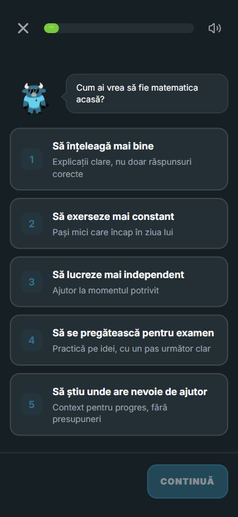
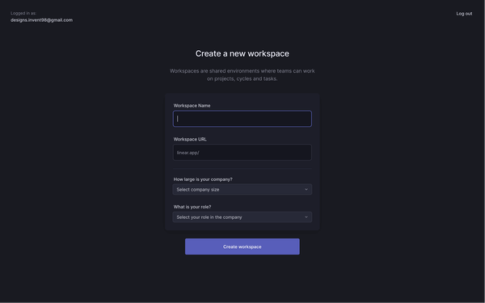
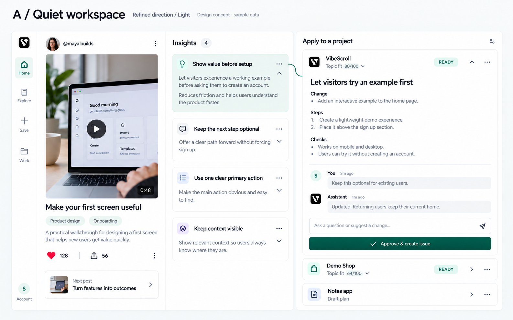

# Onboarding review references

These are visual research references for the [V1/V2 screen review](../../ONBOARDING-V1-V2-REVIEW.md). They are not new VibeScroll UI, approved final compositions or production acceptance. Copyright and trademarks remain with their respective owners. Do not ship third-party screenshot content as product artwork.

## Quiz structure

Owner's Exponential repository, historical October 17 local review, mobile parent flow, first question. Copied unchanged from its saved review archive. Borrow a focused question, visible choices, progress and a persistent action. VibeScroll V1 excludes the mascot, speech bubble, educational domain copy and reward system. A small product-specific diagram takes the visual explanation role.

## Quiet desktop setup

Observed November 2 from the [SaaSUI Linear collection](https://www.saasui.design/application/linear), via its displayed public image. Browser screenshot; source image is 600×375 and appears soft when enlarged. Borrow centered focus and calm hierarchy. Do not copy its dropdowns, multiple simultaneous fields or third-party account details into VibeScroll.

The [Appcues Duolingo walkthrough](https://goodux.appcues.com/blog/duolingo-user-onboarding) supplies further goal/choice/exercise examples. Its screenshot attempt did not produce a valid choice crop, so no misleading local Duolingo image is retained.

## Existing approved Home layout

The existing four VibeScroll renders remain the visual authority for the post/insight/plan stage. They are generated design references with illustrative data, not production screenshots. Do not copy their old share semantics, invented counts or example fit scores into real onboarding.

- [Desktop light](../home-feed-2026-10-30/refined-desktop-light.png)
- [Desktop dark](../home-feed-2026-10-30/refined-desktop-dark.png)
- [Mobile light](../home-feed-2026-10-30/refined-mobile-light.png)
- [Mobile dark](../home-feed-2026-10-30/refined-mobile-dark.png)

Actual accepted production captures from the earlier onboarding walkthrough remain private because they include account/provider screens. The November 2 search-first capture set documents the mistaken quiz removal and is not the target design. New V1 screenshots belong here only after the reviewed flow is built and verified.
