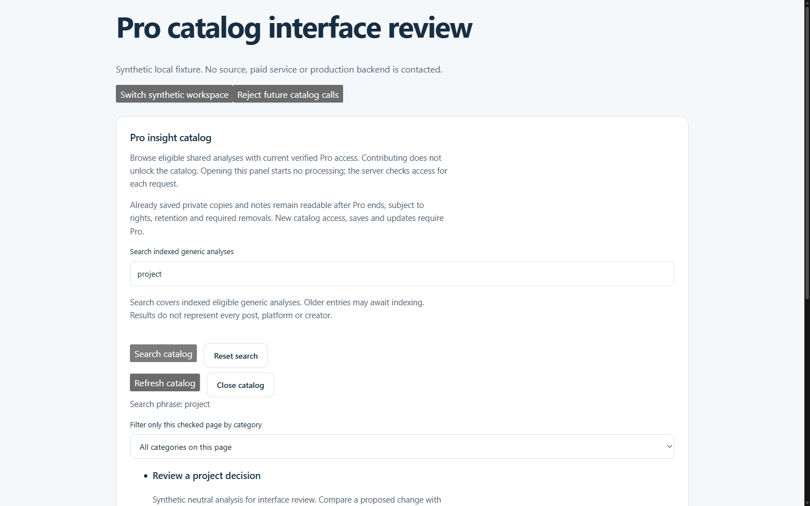
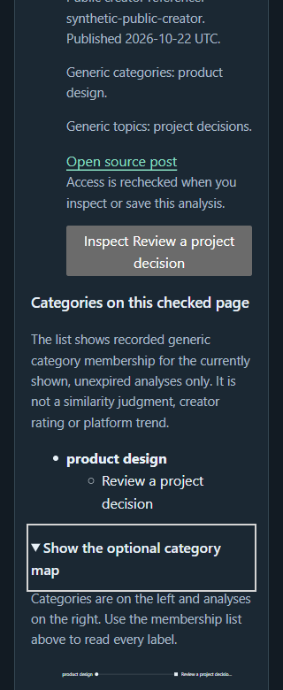
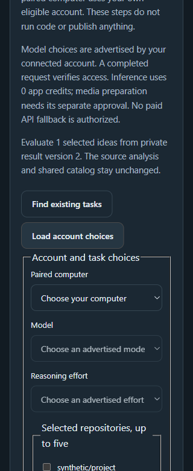

# Completion report, October 24, 2026

Mode: reference. This is the stop checkpoint for the combined original launch, creator/onboarding, Cloud-first and ScrollShow plans. The owner requested finishing the current checks, consolidating the reviewed source into public main and stopping further feature work.

## Completion estimate

About **70% of the planned implementation** is complete, with a reasonable judgment range of **65-80%**. Roughly **10-20% of the expanded plan's production acceptance** has evidence. These are milestone estimates, not code coverage, a claim that all implemented code is live, or a claim that only that fraction of the existing application works.

Use the eleven C0-C10 domains as an equal-weight crosswalk over the original P/R/N/M requirements. Adding every P/R/N/M label separately would count the same work multiple times. Exclude C11 and the explicitly deferred lifetime offer. The following partial-domain scores average about 73% implementation and 11% production evidence; the headline deliberately rounds them.

| Domain                   | Implementation estimate | Production acceptance estimate | Main unfinished work                                                                   |
| ------------------------ | ----------------------: | -----------------------------: | -------------------------------------------------------------------------------------- |
| C0 Official runtime      |                     60% |                             0% | Repeatable supported account/runtime setup and host enforcement                        |
| C1 Real-link media       |                     80% |                             0% | More source formats and complete real evidence beyond the personal Reel proof          |
| C2 Hosted event bridge   |                     20% |                             0% | Actual host subscription, challenge, delivery and execution bridge                     |
| C3 Canonical app return  |                     55% |                             0% | No-GitHub real-link/media return, enforced cancellation, limits and recovery           |
| C4 Pro catalog           |                     95% |                             5% | Migration/activation and real entitlement, content and removal lifecycle               |
| C5 Creator contribution  |                     55% |                             0% | Trusted acquisition-to-artifact binding, recurring contribution and daily completeness |
| C6 Private advanced work |                     80% |                             0% | Approved skills and full media customization                                           |
| C7 Setup and Help        |                     95% |                            20% | Actual host/device and independent beginner acceptance                                 |
| C8 Discovery             |                     95% |                            10% | Index activation and real catalog/contribution lifecycle                               |
| C9 Website and materials |                     90% |                            55% | Remaining native/media/comprehension checks and reviewed offer activation              |
| C10 Integrated release   |                     80% |                            30% | Compatible backend publication, cost proof and full independent acceptance             |

## Implemented and tested in the candidate

- Persisted onboarding extends SetupJourney and CompanionSetup. GitHub and skill installation remain skippable. Instagram guide education is required; actual export/import can happen later.
- Typed source contracts and GitHub/Reddit adapter code preserve currentness, evidence, permission, retention and deletion fences. GitHub-first direction does not open Reddit's separate release gate.
- Ordered video/image/photo/carousel handling, actual decoder/ASR preparation, account/model/effort preflight, one task controller and exact preparation reuse after reconciled failure are implemented. Retained credentials and isolation boundaries remain protected.
- Own-subscription source/project review, proposals and editable plans use the existing queues and approvals. Coding, spending, issue publication, PR creation, merge and deployment retain distinct authority.
- Private text reanalysis stores its immutable full result on the existing run and only small pointers on the source. Explicitly selected private insights now enter project evaluation/proposal/plan flows with exact run/version/output provenance, separate runtime admission and neutral-history isolation.
- Pro catalog access, search, categories, optional checked-page map, public editions/collections/reuse and retained-copy rules are implemented locally. The proprietary corpus stays separate from approved public demos. All-plan contribution is a product direction; recurring subscription-funded contribution is not working yet.
- Creator following configuration, future/latest-ten selection, bounded metadata discovery, delivery controls and honest digest/source status are implemented. Metadata discovery is not proof that the media was acquired or analyzed.
- Default-off Work Cloud text handoff, exact source/task grants and result validation are implemented. This is not the full hosted media execution bridge.
- Purchased allowance commitments, paid-term identity, annual calendar anchors, upgrades/downgrades, refunds and legacy price preservation are tested. The future offer remains a review packet with no invented allowance quantity or new live price.
- Website, example controls, optional motion, product/Library/social media alternatives, Help, repository presentation and unsent acquisition materials are prepared. Help tracing now avoids whole-checkout inclusion.
- Security corrections, versioning, export/deletion/restore, privacy cleanup and bounded operational controls are preserved. Native signed Windows distribution and its actual independent setup remain separate acceptance.

## What is live

The canonical frontend remains the compatible PR141 release at `fba56d44c484260dc98e27174e943ee5ed21af51`, deployment `dpl_FphHKWRbyef8xxqt18ozoxVxpFqs`. The production backend remains `abfdeff6779a2fc7790d4441152117262965fe60`. Vercel's control-plane API reconfirmed the canonical frontend before consolidation, without calling the production application.

The newer candidate features are not serving merely because they are tested or merged into main. [ADR 140](../../adr/140-public-main-consolidation-with-deployment-hold.md) temporarily suppresses automatic main deployment to protect the older compatible backend. It preserves full CI, version tags and GitHub prereleases. The consolidation's final merge SHA and CI outcome belong in its GitHub record.

Public self-service ChatGPT-subscription-to-Cloud-video-to-VibeScroll-result processing is **not complete or verified**. Live Stripe checkout for the expanded offer was **not completed or verified in this run**. Existing prices and purchases remain unchanged; no new live offer or charge was activated.

## What remains

1. Complete the actual hosted event/execution bridge and no-GitHub real-link result return. Prove supported identity, network/resource/usage controls, cancellation, expiry, revocation, unknown completion and cleanup. Do not replace these with task creation or a text-only acknowledgement.
2. Bind trusted acquired/decoded creator bytes to the current delivery/post/watch/source epoch, then attach compatible artifacts before model work. Preserve Pro-before-global-read checks and stop honestly on cache misses. Complete recurring per-user contribution, fair selection, confirmed failover and daily cohort completeness without duplicate consumption or account-limit bypass.
3. Package and verify approved skill bytes in a supported isolated runtime, bind exact selection/content digests to private consent and lineage, and implement full media private variants. Recommendation metadata and protocol types do not establish installation or Cloud availability.
4. Finish complete backend impact and fiscal proof, fund inherited index migrations inside the same cap, publish/verify the backend, then stage and verify the matching frontend before lifting the deployment hold.
5. Verify the current Stripe plugin connection/account contexts and the actual purchase, renewal, portal and refund journey. Prepare and review concrete future allowance/terms/legacy mapping before activating a new offer. Connection permissions are not payment acceptance evidence.
6. Publish the already approved exact seven-insight README edition only after fresh source/hash/rights checks, actual recent sign-in and compatible bounded publication. Do not ask for the same claim/settings approval again.
7. Finish real format/source and physical-device coverage, the forty-clip/two-repository benchmark, independent setup sessions, the ten-person pilot and later usefulness evidence. Recruitment drafts remain unsent and no customers or outcomes are invented.

The owner removed a discretionary wait for an extra OpenAI reply. A documented eligible official route does not need another owner-imposed confirmation. Actual provider contracts, missing technical capabilities, account consent, privacy and funding controls remain facts that cannot be manufactured.

## Verification and limits

The integrated source at `beda8aee0f39ff864106961afb973d2e1807c21a` passed exact-head CI40080227477. The local full check exited0 with **1,761 tests passed and three hosted skips**, 17 finance invariants, zero-warning lint, all types and both production builds. Independent High review cleared the private result/project/runtime/privacy changes after a reproduced superseded-provider retention fix.

The current native browser checkpoint exercised actual hydrated catalog and private-result components with synthetic in-memory replies on loopback. It verified browse/preview/save, explicit search, workspace/error clearing, optional map expansion, twelve-insight selection, exact quote/approval, stale-result rejection, rights expiry and unsupported runtime feedback. It did not use real accounts, model inference or production endpoints. A desktop private-result viewport remained uncompleted after another task changed the shared browser target. Both task-created test tabs were closed, the task's recordings stopped and its static servers exited. Unrelated browser work was preserved.

See [the native receipt](../../operations/evidence/launch-20261024-native-catalog-private.json), [private-text evidence](../../operations/evidence/launch-20261024-private-source-text.json) and [private-project evidence](../../operations/evidence/launch-20261024-private-variant-project.json). Earlier failed fixtures, timeouts, schema integration errors and corrections remain recorded. Passing synthetic checks does not establish production or independent acceptance.

The following screenshots are synthetic localhost engineering tests. Accounts, models and replies are mocked; no processing ran. They use actual component/app styles with a system font and a small fixture frame, not the complete authenticated Console or compiled Tailwind.

## Budget and stop state

The cumulative cap remains **US$3**. Conservative reservations remain **US$2.8092885298898517**, with **US$0.1907114701101483 unallocated**. These are retained holds, not a settled invoice. No unknown hold was released. PR152/153 and the current local browser review made no new production Convex/provider request or purchase.

Feature implementation stops at this checkpoint as requested. Preserve the clean pushed source, public main consolidation record, exact serving versions and the [single remaining-work plan](README.md). No new background automation, provider activation, live billing change or outreach follows.
