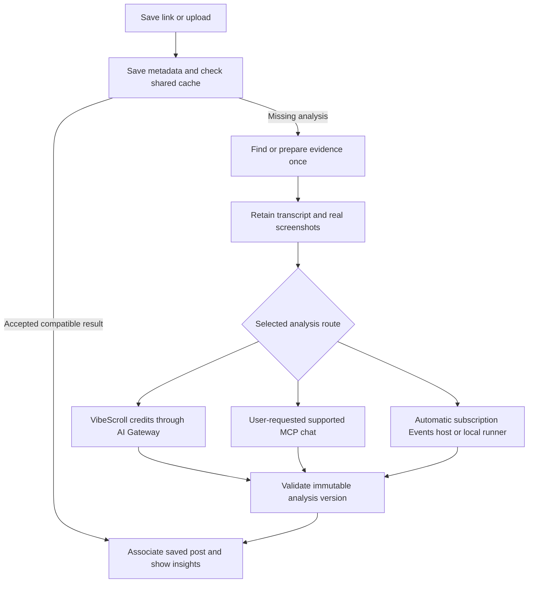

# Deliver insights from reusable prepared evidence

Read [current accepted state](../../operations/CURRENT-STATE.md) and the [owner register](../../strategy/OWNER-REQUEST-REGISTER.md) first. Historical retry/candidate notes below preserve the incident sequence. Prepared Muse and automatic native versions have since saved successfully; integration, managed/prepared shared publication, precise credits and fresh single-pass acceptance remain open.

First hosted attempt, October29: Sandbox preparation35.465s and successful MAI ASR1.904s were measured, but subsequentINVALID_EVIDENCE stopped the run before Muse. The original selected result/catalog remain unchanged. Exact failure condition is unproved because raw ASR coordinates were not retained. [Receipt](../../operations/evidence/launch-20261029-prepared-media-first-attempt.json). [ADR194](../../adr/194-returned-transcription-evidence-and-retry.md) adds private response/diagnostic retention and narrow returned-failure reconciliation before another live attempt. Whole-flow comparison remains unaccepted. Test policy is disabled and all holds remain.

The latest [saved-post/catalog/team direction](../../strategy/POST-SUBSCRIPTIONS-CATALOG-AND-TEAMS.md) is mandatory: base cache reuse for requested posts, separate full-library browsing add-on/toggle, each member's own Pro/credits, preparation quotes and final-only credit rounding. Keep this acceptance sequence aligned with that plan.

Mode: how-to. Owner direction: October 29, 2026. Status: local implementation candidate; hosted comparison and release pending. No provider purchase or billing product is authorized.

Latest owner correction: use yt-dlp and FFmpeg with the existing Vercel Sandbox. Do not add ScrapeCreators, Transloadit, or another acquisition/media-processing service. The owner selected automatic Save through the existing VibeScroll Assistant for the subscription comparison and approved a new USD0.50 envelope, cumulative EUR14, using existing balances only and Vercel strictly below USD20. It covers two fresh preparations, transcription, one Muse analysis and verification. Subscription usage is excluded from cash. Keep every old hold and the reserved post. No new media/API analysis test has started yet.

[ADR191](../../adr/191-prepared-evidence-comparison.md) records the candidate implementation and narrower test enablement. Exact owner/source policy, transactional dispatch, existing native retained-evidence completion, managed provenance, permanent versioned evidence and authenticated metadata subscriptions are implemented locally. Managed/shared publication and wallet billing remain later work; the comparison does not relabel API results as subscription results or replace existing catalog knowledge.

Follow this plan for the next link-to-insights implementation. Read the [versioned analysis plan](VERSIONED-LINK-TO-INSIGHTS.md), [shared intelligence requirements](../../strategy/SHARED-INTELLIGENCE-MOAT.md), and [simple setup requirements](../../strategy/SIMPLE-SETUP-AND-CLOSED-LOOP-PROPOSALS.md) alongside it. Preserve their accepted production behavior. This plan supersedes their next-step recommendation to perform all acquisition and ASR inside the subscription host, and their offline-ASR-only default for the proposed managed route. It does not enable paid fallback for existing subscription jobs.

Owner sequencing update, October 29: postpone the Local Machine executor and its adapter. The active implementation and comparison cover hosted preparation, Muse API and the existing automatic ChatGPT Assistant only. Keep the local choice disabled until a later accepted milestone. Local verification commands are engineering checks, not implementation of the local execution route.

## Pricing target update

Follow the [single-Pro and model-group plan](../../strategy/PRO-PRICING-AND-CREDITS.md): one paid hosted tier, free self-hosted code without the hosted dataset, Muse1×, higher-credit model groups and bounded high reasoning. Compare300/500 credits and digital-root-8 weekly/monthly/annual prices before a versioned migration. P4 must preserve old units/purchases, one pool across workspaces, zero-credit compatible cache hits and no duplicate charge. Measure the pipeline before treating token ceilings and unknown infrastructure time as expected costs. Existing billing mappings and balances remain unchanged.

## Preserve the accepted baseline

Keep the current owner Events route available during implementation. The last recorded accepted website and backend are commit `55887625112942850a9d848f6f686e02e4a1c382`. Its automatic TikTok completed with 34 transcript segments, eight verified JPEGs, four insights, and shared publication in about 5 minutes 50 seconds. This is historical acceptance, not a fresh deployment check.

Use the completed model experiment from Codex chat `01a18481-b50d-7d93-94ad-e276b251576b`, titled Compare video model options. The source artifacts are in `C:/Code/VibeScroller/outputs/model-research/2026-10-29/`. Read `benchmark-report.md`, `ux-latency-addendum.md`, `sandbox-runtime-decision.md`, and `managed-media-processing.md` before implementation. Preserve their raw outputs and billing receipts. The experiment spent USD1.82404 of its separate USD2 allowance and revoked its key. Its remaining allowance is not a budget for this implementation.

Do not repeat the 22-model sweep. Use these measured candidates:

| Role                                 | Configuration                             | Recorded result and limitation                                                                                                                                                                       |
| ------------------------------------ | ----------------------------------------- | ---------------------------------------------------------------------------------------------------------------------------------------------------------------------------------------------------- |
| Inexpensive public-evidence analysis | `meta/muse-spark-1.3-contributor`, medium | Original-reel provisional pass, 87.5/100, 42.7 seconds, USD0.00342 analysis. High took 34.9 seconds and scored 85.5 in one paired observation. Neither effort is established as consistently better. |
| Quality analysis or escalation       | `openai/gpt-6.1-terra`, medium            | Provisional pass, 88.5/100, 29.4 seconds, USD0.04432 analysis. This is the practical measured speed/quality choice.                                                                                  |
| Targeted review                      | `openai/gpt-6.1-sol`, high                | Use for exceptional or sampled review. Do not add a judge to every inexpensive analysis.                                                                                                             |
| First ASR candidate                  | `microsoft/mai-transcribe-2`              | Two calls took 2.538 and 2.287 seconds, costing USD0.00289412 each for the common 104.176-second reel. WAV extraction and transfer are excluded.                                                     |
| Alternative ASR candidate            | `elevenlabs/scribe-v2`                    | Two calls took 4.579 and 3.860 seconds, costing USD0.00318108 each. Accepted the source MP4 in this experiment, which can remove audio conversion. Promotional pricing expires.                      |
| Optional later native-video route    | `google/gemini-4-argon`, high             | Strongest native-video candidate in this pilot, but 82.7 seconds and USD0.07311 analysis. Do not replace the budget frame route on the assumption that native video is faster.                       |

The scores come from a small pilot and one Sol judge, with possible family bias. They are not population accuracy or production reliability. The experiment's three provisional backlog versions remain local artifacts with `appSaved=false`. Do not claim that they populated the live app or overwrite existing/unknown app jobs to import them.

## Use one backend with several analysis executors

Implement this logical flow:

Start preparation after a supported Save without waiting for a model to manage downloads. Publish metadata as it arrives. Resolve image/carousel content to real original images without a video decoder. Support Instagram Reels and TikTok first. Preserve existing platform handling and report unsupported sources honestly.

Use compatible in-flight producer/waiter coordination before spending. Keep each user's association, private overlays, requested funding, and model selection separate. Reanalysis bypasses only the analysis cache unless the owner deliberately requests new evidence. Preserve the incumbent while a candidate runs or fails.

## Keep the service choices explicit

| Component                                                             | Initial implementation                                                                                              | Alternative and selection rule                                                                                                                         |
| --------------------------------------------------------------------- | ------------------------------------------------------------------------------------------------------------------- | ------------------------------------------------------------------------------------------------------------------------------------------------------ |
| Website and server endpoints                                          | Existing Next.js application on Vercel                                                                              | Keep the current deployment architecture and Basic queued builds.                                                                                      |
| Durable jobs, access, shared cache, versions, and credit reservations | Existing Convex backend and Workflow component                                                                      | Reuse existing records and transactional producer/waiter behavior. Do not add another queue or database.                                               |
| Original source resolution and download                               | Verified current yt-dlp inside the existing isolated worker                                                         | Reuse one extraction and download. Do not introduce another acquisition provider.                                                                      |
| Timestamped screenshot and audio preparation                          | Existing Vercel Sandbox abstraction, Frankfurt, pinned clean tools, FFmpeg and FFprobe, explicit `persistent:false` | Measure actual startup, processing, transfer, teardown, and costs. Keep the existing provider.                                                         |
| Transcript                                                            | Valid native captions first, otherwise an approved Gateway ASR adapter                                              | Compare full MAI plus audio-conversion time against Scribe plus original-media transfer. No hidden paid ASR on old zero-API jobs.                      |
| Model inference                                                       | Vercel AI Gateway from the trusted backend                                                                          | Pin the exact model, allowed provider, effort, schema, token ceiling, and funding. Call neither ASR nor the insight model from a waiting media VM.     |
| Durable evidence                                                      | Existing private EU Cloudflare R2 object storage with Convex manifests                                              | Keep the authenticated asset routes and shared service ownership. Do not introduce a public bucket or provider-owned permanent media store by default. |
| Subscription execution                                                | Existing authenticated MCP connection and supported native host or local client                                     | A foreground evidence-analysis tool path needs actual supported-host acceptance. Automatic Events remains a separate supported-host capability.        |
| Payments                                                              | Existing wallet and billing integration                                                                             | Prepare compatible credit accounting. Do not create or activate new live products or checkout charges as part of planning.                             |

Use a pinned verified downloader update rather than a floating latest binary. The separate benchmark used yt-dlp 2026.10.26; the older hosted acquisition helper expects 2026.08.19. Review both actual routes before changing pins. This difference does not, by itself, diagnose production failures.

Contributor permits provider use of inputs and outputs to improve products. Enforce the selected provider policy in the backend. Exclude private project/repository context from that route and do not treat public source availability as universal reuse authority. Terra is a measured quality option when the applicable account/provider policy allows it. GLM can remain a low-cost experiment candidate, but its content errors make it an unsuitable unconditional fallback.

## Build the evidence and completion contracts first

1. Add a first-class preparation record before any initial analysis exists. Reuse compatible source/evidence tables and independent storage ownership instead of building a second catalog.
2. Bind the record to canonical source identity, content revision, actual media hash/duration, language, caption or ASR provenance, extraction recipe, frame timestamps/hashes/dimensions, and retention policy.
3. Record service preparation separately from subscription analysis. Existing initial Cloud validation assumes the authenticated Cloud job prepared the source. Generalize that boundary without fabricating a completed baseline or claiming that service processing happened inside ChatGPT.
4. Give preparation and analysis separate leases and stage retries. One logical analysis must not consume the user allowance twice. Preserve uncertain provider outcomes and reconcile them before repeating paid work.
5. Add a validated Gateway completion path with actual model/provider/effort, request IDs, token usage, costs, prompt/schema hash, evidence reference, and funding receipt. Do not submit paid Gateway results through an own-plan receipt requiring zero API usage.
6. Use the same immutable version and publication boundary for Gateway and MCP results. Keep exact historical evidence access and rollback. Pin or compare versions without new extraction or inference.

Retain transcripts and sampled evidence until deletion, withdrawal, or takedown under the accepted retention policy. Keep original audio/video temporary. Never retain raw video forever merely to support permanent analysis history.

## Measure both complete analysis routes with the existing media tools

Instrument the existing worker before optimizing it. Give every run one trace ID with explicit timing boundaries:

- Save acknowledgement, queue wait, and cache lookup.
- Sandbox credential bridge, creation, clean-image restoration, and readiness.
- Source resolution, media download, probing, and validation.
- Audio conversion and artifact transfer.
- Screenshot decoding and artifact transfer.
- ASR request and response.
- Model request, first response byte, and complete response.
- Result validation, durable storage, shared publication, and user-visible readiness.
- Stop/delete request, acknowledged teardown, orphan reconciliation, and metered-cost reconciliation.

Measure source time to usable evidence, not API time to metadata JSON. Keep local timings distinct from actual hosted measurements. Record cold/warm conditions explicitly. Use the same source bytes, resolution, caption mode, timestamps, and output dimensions for comparative tests. Start with a small bounded hosted sample, then a mixed permitted sample if the ledger supports it. Report sample counts and ranges; estimate median/slow-tail behavior only when the sample warrants it.

Run pinned yt-dlp plus FFmpeg in the current Sandbox, with one metadata extraction reused for download. Compare Muse API analysis and the selected ChatGPT subscription entry point on the same permitted source. Make separate fresh preparation passes for full uncached timings without deleting global caches or disturbing existing results. Freeze equivalent transcript/frame recipes, prompts, and output limits. Report analysis-only comparison on identical evidence separately from end-to-end processing. A shared-cache hit must never masquerade as a fresh full pipeline run.

Use the same approved ASR path for both proposed prepared-evidence routes. Record API ASR as infrastructure funding even when final analysis uses the subscription. Label a test of the old host-preparation route separately because its transcription/runtime differ. Keep unknown existing attempts, protected sources, and incumbent results unchanged.

Measure title, author, duration, thumbnail readiness, each visible processing stage, first validated insights, saved version, and shared publication. Record backend commit times and actual browser observations. Use Convex reactive queries for detail and metadata lists. Save the post immediately, persist native metadata before downloading the full media when available, and retain the thumbnail as soon as it can be verified. Do not hold all metadata until final analysis. Report stages and elapsed time instead of invented progress percentages. Test that these updates arrive without a manual refresh.

Keep the current Vercel media runtime. No alternate downloader API, managed frame service, provider subscription, or new container host belongs in this acceptance.

## Optimize only the required preparation

Use a small tools-only image without ASR model installation for the proposed API-transcription route. Disable persistence for source jobs. Keep source-network access bounded, then decode without source networking. Export outputs through the reviewed controller or narrowly scoped upload capability. Never put broad storage or Gateway credentials in the decoder.

Acquire once. Start ASR when its required audio or original-media input is available, while frame extraction proceeds independently. Stop the Sandbox after required output transfer. It must not remain alive during model inference, native task wakeup, or an external transcription response that no longer needs the VM.

Freeze a deterministic initial sampling recipe with 8-12 real frames, including the start, final decodable moment, and useful scene changes. Respect each model route's actual image-count limit. Use only supported bounds and unique supplied frame IDs. Preserve enough resolution for visible UI text. Keep thumbnail selection separate from evidence selection. Adaptive sampling changes the extraction recipe and requires a new comparison packet.

Validate caption language, segment bounds, and provenance. Never substitute a post description for audio transcription. Permit no-speech output and visual-only analysis. Store ASR once and let the analysis cite segment IDs instead of paying the model to reproduce the transcript. Preserve corrections separately from original ASR.

Validate output size, JSON shape, supplied frame/segment references, and time ranges outside the model. A schema-valid answer can still invent events. Permit audited unambiguous identifier normalization, but never silently change invented claims or clamp impossible timestamps into acceptance. Use sampled or flagged review rather than automatically doubling latency with a judge.

## Separate the user flows and funding

### Run automatically with VibeScroll credits

Save the post, check eligible cache reuse, reserve the selected bounded processing price, and enqueue missing preparation. When evidence is ready, call the selected approved Gateway model. Validate and publish a new immutable version, associate the user's save, settle the reservation, and notify the application. Release unused reservations. Reconcile uncertain upstream usage instead of treating a client timeout as a free request.

An ordinary shared hit starts no new AI job or new AI-processing charge. Shared-catalog access can retain its separate product entitlement. Different simultaneous model requests can share evidence but need separate justified analysis versions and explicit funding. Fix reservation ownership so followers do not spend from another user's wallet or subscription.

### Analyze prepared evidence in the user's assistant

Expose bounded MCP reads for the prepared transcript and actual image content, plus a scoped completion tool. The user asks a supported ChatGPT/Codex host to analyze an existing post. The host inspects actual images, produces insights, and saves through the same validator and immutable version path. No downloader, FFmpeg, Python bootstrap, or ASR model setup is required in that host.

Test available hosts explicitly. Do not advertise every ordinary ChatGPT chat as supported based on MCP protocol capability alone. Saved evidence does not provide a backend API into a consumer subscription.

### Run automatically through the user's subscription

Keep the existing native Events mechanism for supported Work hosts, with the monitor's analysis action changed to consume prepared evidence. Send one logical evidence-ready dispatch, with idempotent callbacks and a compatibility transition from the current Save/waiting sequence. Do not wake the model solely to orchestrate preparation and then wake it again for the same analysis. Keep a user's active task and current grants intact until the replacement action passes acceptance.

The local route can claim the same evidence-based analysis job through the supported official client and requires the computer to be available. Never pool the owner's subscription across customers. Preparation and API ASR remain VibeScroll infrastructure costs even when final reasoning uses a user's subscription. Cover them through an explicit included allowance or quoted credits; do not label the whole process free.

Preserve the three requested task locations. A future change to the recommended/default option requires actual route acceptance and a corresponding settings update. Do not silently change the owner's selected funding route during this implementation.

## Include runtime in the cost and latency decision

For a frame-based uncached run, calculate critical-path latency as queue plus worker startup plus acquisition, plus the slower of complete frame delivery and complete transcript delivery, plus analysis, validation, and persistence. Start each branch at its actual dependency point. For the credit route there is no ChatGPT monitor wakeup. Subscription automatic runs add the measured native-host wakeup and tool-read time.

The common-reel composed estimate for Terra was 44.7-46.8 seconds and Muse Contributor high was 50.2-52.3 seconds. Those sums exclude hosted startup, queueing, storage/export, validation, saving, and retries. Do not advertise them as production results. Set a provisional engineering goal near one minute for an ordinary short clip and measure the actual range before committing to a user-facing SLA. Keep a truthful delayed state for the slow tail.

At the October 29 Frankfurt Sandbox rates, active CPU is USD0.184 per vCPU-hour, memory is USD0.0304 per GB-hour with a one-minute minimum, and creation is USD0.60 per million. A hypothetical fully busy 30-second, two-vCPU/four-GB job costs about USD0.00509 compute. This is not a measured bill.

Combine that scenario with measured Muse medium USD0.00342 plus MAI USD0.00289412 and the subtotal is about USD0.01141 per comparable video, or USD5.70 for 500. That excludes data transfer, storage, other backend usage, failures, payments, taxes, margin, and support. With Scribe the comparable subtotal is about USD0.01170, or USD5.85 per 500 at the observed promotional ASR rate. Native captions and shared hits reduce new processing. Longer clips and repeated attempts increase it.

Use this full formula before setting a credit pack: acquisition + isolated compute + ASR + analysis and billed reasoning + transfer/storage + backend operations + expected failures and payment costs. Separate metered usage from currently included credits and prepaid-provider commitments. Check price expiry, provider endpoint, region, and cache-write charges. Do not promise 500 arbitrary uncached videos for EUR5 based on inference alone.

## Deliver and test in phases

Backend4892434's strict schema is accepted by Gateway, but its Muse answer failed application validation after45.911s/USD0.0017286. Actual content/error detail was not retained. [ADR198](../../adr/198-retained-model-output-and-trusted-bindings.md) fixes output retention, server bindings and exact citations, and separates retained API/native analysis from fresh preparation quotas. One replacement Muse answer and known-unused Gateway reconciliation are owner-approved within the same limits. Prepared-route success remains unclaimed.

The ADR196 optional-mode retry was deployed at8f0435a but Gateway rejected it with the same HTTP400 and confirmed zero inference/cost. [ADR197](../../adr/197-gateway-strict-schema-and-prepared-save-reuse.md) replaces that adapter assumption with a fully required compatible provider schema. The native app-Save comparison will reuse the same successful evidence instead of spending the optional fourth fresh preparation. Report its reuse latency separately from fresh preparation and human debugging time. No successful prepared Muse/native comparison is claimed yet.

October29 progress: compatible backend809668e is live; the source-bounded PCM fix passed the third hosted preparation with zero ASR overflow and retained real images. Muse stopped on a zero-token HTTP400 optional-schema rejection. [ADR196](../../adr/196-muse-optional-schema-and-retained-retry.md) corrects the supported schema mode and defines one finite explicit retry from retained evidence. The extra two fresh passes are approved, four total. Full API and automatic native comparisons, managed shared publication and settlement remain open.

| Phase | Work                                                                                                                      | Acceptance and release checkpoint                                                                                                                                                                                                                                                                                                        |
| ----- | ------------------------------------------------------------------------------------------------------------------------- | ---------------------------------------------------------------------------------------------------------------------------------------------------------------------------------------------------------------------------------------------------------------------------------------------------------------------------------------- |
| P0    | Preserve benchmark conclusions, existing production receipts, data, and this linked plan                                  | Complete as documentation. No new live calls or deployment.                                                                                                                                                                                                                                                                              |
| P1    | Add prepared-evidence/service provenance and truthful managed completion contracts; define trace fields and fixtures      | Existing completed/history/shared records remain readable. Initial service evidence requires no fabricated completed Cloud baseline. Wrong source/hash/model/funding and stale lease are rejected. No production enablement yet.                                                                                                         |
| P2    | Instrument and simplify existing Sandbox; measure complete Muse and subscription flows                                    | Actual hosted creation-to-stored-evidence timing, real JPEGs/thumbnail, separate ASR branch timing, teardown receipts, and cost envelope. Verify early metadata and live UI updates without refresh. First measured infrastructure checkpoint.                                                                                           |
| P3    | Connect caption/API-ASR preparation and the chosen Gateway analysis route                                                 | One complete permitted Reel or TikTok saves a new truthful managed version and shared artifact with real evidence. Keep incumbent results and zero-API jobs intact. Release the accepted route behind its actual availability/funding controls.                                                                                          |
| P4    | Add wallet reserve/settle and shared concurrency/reanalysis acceptance                                                    | Duplicate Save/completion creates no extra job or charge. Two accounts keep their own association, compatible requests coalesce, different model runs retain separate versions, and reanalysis reuses evidence. Use isolated races first; no new production race test is required.                                                       |
| P5    | Connect foreground MCP evidence analysis, then simplify the native automatic subscription action; defer the local adapter | Actual supported host inspects images, saves a version, and handles a duplicate safely. Native monitor remains active after completion. Revocation and unavailable host produce honest status without paid fallback.                                                                                                                     |
| P6    | Complete mixed-source canaries, release, verify, and update setup guidance                                                | Real caption, ASR, no-speech, blocked/deleted media, expired URL, unknown timeout, large/long input, callback replay, and partial upload outcomes. Verify exact deployed code, persisted results, authenticated evidence, cache reuse, progress, retention, and rollback. Report actual measured latency/cost and open commercial gates. |

Use offline/synthetic fixtures for failures before live tests. Reuse permitted benchmark evidence for regression without reacquiring protected sources or overwriting their app attempts. Live attempts require a current reserved envelope. Preserve all old unknown holds and the reserved post. A local benchmark of a reserved source does not authorize a new production job for it.

Use exact-head CI and the existing compatible release guards. Keep fixed Basic queued builds, the shared cumulative ledger, and Vercel strictly below USD20. Recheck current usage before hosted tests. The owner's delegated routine release authority removes per-release count questions, not monetary or provider limits. No new payment products, credit purchase, alternate media service, or paid fallback follows from this plan.

Ship useful accepted backend checkpoints rather than a widget redesign. Update the [implementation status](../../implementation-status.md), this acceptance table, and the parent plan after each release. Continue exact-version project follow-up and the issue/PR feedback loop after the link-to-insights path is accepted.

## Verify the provider references before activation

- [Sandbox pricing](https://vercel.com/docs/sandbox/pricing) and [pinned custom images](https://vercel.com/docs/sandbox/concepts/images).
- [Gateway speech-to-text](https://vercel.com/docs/ai-gateway/modalities/speech-to-text), [live model catalog](https://ai-gateway.vercel.sh/v1/models), and [Gateway pricing](https://vercel.com/docs/ai-gateway/pricing).
- [Meta model pricing and Contributor terms distinction](https://dev.meta.ai/models/muse-spark).
- [OpenAI MCP tools](https://developers.openai.com/plugins/build/mcp-server) and [native Events](https://developers.openai.com/plugins/build/mcp-events).

The completed benchmark supplies model compatibility/quality observations. Official documentation supplies advertised capability and pricing. Neither substitutes for the hosted acceptance receipts required above.

## October29 prepared-route checkpoint and deferred ChatGPT UI

Both prepared-model routes now save immutable private candidates on backend4fefc65, using identical retained transcript/JPEG evidence. Muse queued-to-stored62.713s; automatic native189.216s. Separate fresh preparation41.093s; these are not two fresh full-link trials. Original selection is preserved and the native monitor remains active. Legacy source-runtime cache failure, managed/prepared shared publication and precise customer credits remain open. See the [comparison receipt](../../operations/evidence/launch-20261029-prepared-model-comparison.json).

The owner deferred embedded ChatGPT UI on October29. Production will use ordinary MCP tools and saved-result website links; do not recreate or visually redesign the widget now. OAuth, Events and the existing plugin stay connected. ADR199 also corrects prepared versions incorrectly labelled removed by history. This combined change is a local candidate until exact CI/publication and read-back pass.

Production acceptance: fc2ef42 is live after exact CI40923237655,22 guards and a41.749s fixed Basic build. Canonical setup has embedded UI disabled. Original MCP automatic analysis remains enabled without setup/reconnection. Prepared history returns versions1/2/3 Ready with original selection unchanged. Temporary comparison policy/key are removed/revoked. No new analysis ran. Managed/prepared shared publication, precise customer credits and the legacy source-runtime cache correction remain open.
