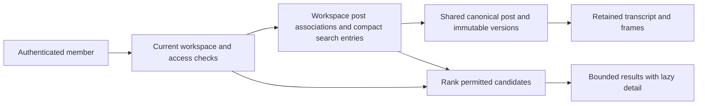

# Context-aware post and insight retrieval

Status: scoped retrieval milestone accepted in production under R141/R142, November 1, 2026. [Extended receipt](../operations/evidence/launch-20261101-context-retrieval-extended.json). R138/R139 specify question-aware retrieval and complete retained post references; R140 adds bounded workspace/team search. R141 approves continuing all these recommendations. Follow the [execution ledger](CONTEXT-RETRIEVAL-IMPLEMENTATION.md). No new semantic provider or paid embedding route is active merely because implementation is authorized. The eight separate R137 later suggestions remain deferred.

## Current behavior

Website/backend72df4f7 deploy both R141/R142 checkpoints. [The dated receipt](../operations/evidence/launch-20261101-context-retrieval.json) distinguishes local, host and production evidence. Compatible legacy search still examines five permitted posts. Opt-in `ranked_v1` uses a compact workspace full-text projection, at most50 candidates/8 hydrated sources/20matches per call and200 candidates per signed continuation session. Owner initial coverage is210 saved sources. Current access is rechecked before disclosure, including exact team shares.

`fetch(format="post_context_v1")` expands an explicit immutable post reference into bounded pages of complete retained transcript, observations and insights plus one frame manifest. `read_post_frame` returns verified native JPEG bytes without a worker lease or new analysis. The actual ChatGPT test retrieved complete context/search results and all8 frames across initial/sequential reads. Three initial host errors remain unexplained; one-at-a-time image reads passed. Legacy/structured summaries remain compatible.

The second checkpoint deploys optional filters, selected-project topic fit and explicit bounded multi-workspace search. R142 approves automatic personal/joined-team MCP defaults, preserving explicit per-client off/custom access, current membership/role/own Pro and personal-post isolation. The extended receipt records actual optional-argument/cursor acceptance and separately identifies isolated team/filter enforcement tests.

The source-free [quality investigation](../operations/RETRIEVAL-QUALITY-20261101.md) records exact/category hits, a paraphrase miss and bounded host query expansion as the next economical route. Embeddings and another search provider remain deferred pending real expected-hit and index-cost evidence.

## Bound search to a workspace

R140 extends the next milestone to efficient personal and multi-member workspace retrieval. Preserve all R138/R139 capabilities. Authorization scoping exists today; the compact workspace projection is deployed at the first checkpoint; additional routing/filter/federation and automatic team defaults are deployed at the second checkpoint.

Current `assistant.search` first resolves the selected organization and current actor/client grant. `assistantGrant` checks indexed membership, active scopes and the member's team subscription. Candidate enumeration uses organization-prefixed `dashboardCards` or `sourceSpaces` indexes, or the older explicit-source grant. `sourceWithinAssistantScope` rechecks organization, allowed sources/space, retention and underlying evidence authority. It does not search the service-owned canonical catalog. The grant value `libraryScope: all` means all permitted source cards in that organization, not all VibeScroll content. Each request examines at most five source candidates and128 insights per source, returning at most twenty results. These are logical scan limits, not a measurement of total database bytes or a guarantee of library-wide relevance.

Team knowledge currently has separate recipient-indexed grant listing and exact shared fetch in `knowledgeGrants.ts`. Opt-in ranked search merges exact currently granted team origins into the workspace collection. Default legacy search retains its own-source scan. Keep those modes explicit.

Use this target ownership model:

Each personal account has a personal workspace collection. A team has one shared collection, with one association per canonical post in that workspace, rather than one copy per member. Team members search content saved or explicitly shared into that workspace. Joining a team does not publish a member's personal library into it. Private notes and restricted project material retain their own access checks. Members still use their own Pro and credit pool for new processing.

An association identifies the workspace, canonical post, permitted version selection and provenance of access. Preserve existing local source IDs and owner/share semantics during migration. Multiple valid paths can grant access to the same post: withdrawing one share must not remove a separate direct workspace save. Duplicate concurrent saves upsert one association and preserve each requester's durable Save/activity receipt. Do not copy canonical analysis or media to implement a collection.

Create a compact search projection per workspace and content/version, containing only the text and ranking fields needed for discovery. Keep large transcript chunks, vectors, images and full analysis bodies out of ordinary result documents. Team search storage scales with unique subscribed content in that team, not member count. A popular post can have one canonical embedding computation reused across workspaces; searchable projections may still duplicate text or vectors when the selected backend requires that. Do not promise physical index deduplication from an ID reference alone.

The server resolves the allowed workspace set before candidate retrieval. Default to the active workspace; an explicit all-my-workspaces request performs bounded fan-out over currently authorized workspaces, deduplicates canonical post/version hits and returns their workspace provenance. The model cannot grant access by supplying a workspace ID. Global catalog search remains a separate entitlement and explicit mode, never a silent fallback after zero local matches.

Enforce row, result, serialized-byte and elapsed-work limits for each request, plus an overall page/candidate budget for each retrieval session. Return partial coverage and continuation when that budget is reached; do not automatically traverse an entire large workspace because each individual call is small. Exact post lookup bypasses discovery. For discovery, use declared topic/project/time/platform constraints and deterministic candidate ranking, then optional semantic reranking within the permitted bounded set. Avoid exact keyword prefilters that make semantic-only matches impossible without reporting that limitation.

Five posts is the current conservative scan-page size, not a target for final search quality. It bounds reads of potentially large saved analysis documents, but may need many calls and does not select the most relevant candidates across a large workspace. Benchmark5/10/20-post scan pages against realistic libraries before changing that compatibility default. The preferred indexed design retrieves lightweight ranked candidates first. Evaluate50/100 compact candidates and return10/20 top matches within byte/time limits, without loading every candidate's transcript or screenshots. These are experiment settings, not deployed limits or a promise of exhaustive semantic recall. A five-result answer can be useful if selected from the workspace-wide authorized index; examining only five arbitrary posts is a different limitation.

Membership and access remain server-authoritative on every detail/image read. Cursor and result-cache identity must include workspace, normalized query/filters, selected content/index revision and access/grant revision. A team-shared candidate cache can be reused only where its visibility is identical for all members; actor-specific restrictions require actor-specific keys or uncached revalidation. Membership removal, share revocation, takedown and version changes invalidate or reject stale continuations. An asynchronous search projection may lag; current authority still blocks disclosure, and coverage exposes pending indexing.

Workspace filtering and physical cost isolation are separate. Convex search equality filters restrict candidates but its documented query-GB accounting still uses the full index. Start with the existing organization-prefixed bounded database reads and measure compact indexed projections. If semantic adoption makes a global index expensive, benchmark a search service or supported partition design with real workspace-level index/namespace isolation before choosing it. Do not provision one database per user, build a custom search engine or add another provider merely to solve a scale problem that is not measured yet.

Acceptance must cover two disjoint personal workspaces, a shared team, a member's unshared personal post, concurrent duplicate saves, multiple access paths, revoked membership/share during pagination, mixed retired evidence, large team membership, cross-workspace deduplication and indexing lag. Assert no global-corpus candidate enumeration, bounded reads/bytes/pages, exact detail authorization and no extra canonical asset/embedding computation per member. Measure index storage/query cost separately from result count.

## Proposed retrieval shape

Keep post and insight records separate in storage. Offer a compatible opt-in representation that returns a bounded insight list plus one lightweight post record per referenced post, keyed by source ID. Avoid repeating creator/title/category metadata for every hit. Return exact version, source and insight IDs, current state and scope/coverage. Fetch full analysis, project context or evidence only when needed.

Thumbnails should use an authorized application/resource route. Do not copy arbitrary provider URLs or signed private asset capabilities into general model context. Showing a thumbnail in the app and giving a model actual image pixels are different operations. An evidence-on-demand route must have its own scoped contract; the current leased worker image tool is not a general library image reader.

Prefer a compatible extension of existing search rather than overlapping tools. Candidate fields are an optional target (`posts`, `insights` or `both`), bounded filters and a selected project reference. Preserve existing defaults. Bind new cursor state to the target, filters and authorized context as well as the query/version state.

## Route the question

| User question                                | Retrieval                                                                                                                                |
| -------------------------------------------- | ---------------------------------------------------------------------------------------------------------------------------------------- |
| “Find the Reel I saved yesterday”            | Post date, platform, creator and title metadata; inspect its insights after selection.                                                   |
| “What ideas do I have about retries?”        | Insight relevance first, with compact post context and citations.                                                                        |
| “What could help this project?”              | Confirm one current project profile, retrieve relevant insight candidates, then explain topic fit and existing proposal/history signals. |
| “Have we already used this idea?”            | Exact insight/version and same-project proposal/work references, with observed versus reported outcomes.                                 |
| “Create something in the style of this post” | Exact retained post/version context, including transcript, screenshots and insights, with each frame delivered once.                     |

The active assistant can interpret intent; browsing does not need a second paid classifier. Start with text, categories and existing deterministic history/recency signals. Treat similarity as a recommendation, not proof of usefulness. Avoid inflating scores or treating an old project profile as inspected repository code.

## Expand an explicit post reference

The owner wants an agent to retrieve the whole retained context when referring to one post explicitly. Return metadata, the complete retained transcript, sampled frames, insights and the selected immutable version. Include coverage, timestamps and content hashes so the agent can distinguish retained evidence from an original full video. Missing evidence must be explicit.

Deliver frame pixels once in a frame collection keyed by stable asset identity. Insight citations point to those frame IDs and timestamps instead of embedding the same JPEG again. Transcript segments use the same principle. A single response can deduplicate images reliably. Across separate calls, an optional known-frame hint can avoid unnecessary transfer, but it does not prove the host still retains or inspected those pixels. The agent must be able to request them again.

Use an ordinary authorized read contract with bounded parts and continuation. Do not create or claim an analysis job merely to borrow its leased worker-frame tool. An exact source/version reference resolves directly; it does not need semantic search. Share prepared bytes across model analyses without copying them into every insight record. Retained JPEGs currently use private EU R2 storage, so asset delivery and Convex document bandwidth are different costs.

## Semantic search and cost

Semantic search compares numerical representations, called embeddings, to find related meaning. A query for clearer onboarding can retrieve an insight about reducing signup friction even without matching those exact words. Combine it with exact title/creator/link lookup and full-text matching so precise references remain dependable.

Compute an embedding once per canonical content hash and embedding-model version, then reuse it for authorized users. Keep personal notes and project context separate from shared neutral content. Every candidate still needs current authorization and source/version checks. The default search remains the user's requested posts; full-catalog discovery retains its separate entitlement.

Convex supports indexed full-text search and vector search. Vector search runs in an action, followed by transactional hydration and current authorization. Its search and the hydration do not share one database snapshot. Do not take a small global nearest-neighbor set, discard unauthorized rows and then claim the library contains no matches. Compare permission-aware candidate selection with lightweight per-user projections, including the latter's storage duplication.

Costs include embedding generation, index storage and search usage, plus returned document/asset bytes and the receiving model's context. Convex meters both full-text and vector queries against the full searched index size even when filters or small result limits are used. For example, a 1 GB index queried 10,000 times represents about 10,000 query GB before the applicable allowance. Actual pricing depends on the account and region; the default US pricing page is not proof of this application's EU bill. Sources: [vector search and costs](https://docs.convex.dev/search/vector-search#costs), [full-text costs](https://docs.convex.dev/search/text-search#costs), [pricing](https://www.convex.dev/pricing).

Whole-post expansion does not require another download, transcription or analysis when retained evidence is valid. It transfers more data and may consume more of the host's text/vision context. Search should therefore stay small until the user explicitly requests that context. Never attach every transcript and image to every search result.

## Implementation order after R137 acceptance

1. Record realistic owner questions and current expected hits. Measure result quality, duplicate post metadata, serialized bytes, actual database reads and latency. Keep host tokens/provider spend separate.
2. Add explicit retained-post expansion, frame/segment identity deduplication and bounded delivery. Verify actual native image input without worker leases or a new analysis.
3. Add a domain-owned workspace collection/search projection, including existing team shares, compact post/insight results and optional target/filters. Reuse exact IDs and compatible clients; keep details/evidence lazy. Verify scope isolation and cumulative retrieval budgets before expanding search.
4. Add context-aware routing and explainable deterministic ranking using confirmed project context and permitted existing proposal history. No model call merely to browse.
5. If the measured library workload needs it, prepare an authorized full-text projection/index and bounded migration. Consider semantic retrieval only if text/category retrieval misses useful questions. Review its indexing cost, data boundary, invalidation and migration separately.
6. Verify explicit references, image deduplication, post-versus-insight queries, many hits from one post, retired neighbors, repeated pages, changed selection, revocation, cross-user cache reuse, project isolation and stale context. Compare quality and p50/p95/bytes against the baseline before promotion.

The scoped retrieval milestone is deployed and accepted. A real expected-hit workload and actual index-cost measurements govern the conditional semantic follow-up. Broader graph exploration, community rankings and changes-since discovery remain in their existing separate backlogs.
