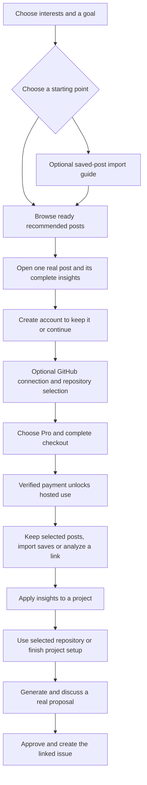

# Interest-led onboarding with real cached posts

Mode: explanation and proposed implementation plan. Updated November 1, 2026, Europe/Berlin.

Status: implementation approved by the owner on November 1, 2026. The owner approves one complete curated result before payment and allows GitHub connection after signup but before payment. Recommended account timing is before payment. The first bounded checkpoint is live at3fc0669; the execution ledger distinguishes production from the completion candidate and remaining fresh-account acceptance. This document does not change production entitlements, pricing or funding.

## November2 refinement

R145 replaces the required quiz with [search-first onboarding](../design/SEARCH-FIRST-ONBOARDING.md). The ready collection, one complete preview, account/payment contracts and saved progress remain. Remove the mascot, redundant labels and dropdowns; use a short Home tutorial and direct choices. Earlier quiz screens below are historical design context, not the new entry requirement.

## Direction and prior decisions

Replace the proposed synthetic onboarding example with real posts whose retained insights are already ready. Ask about interests, recommend relevant posts, and teach the existing post-to-insight-to-project workflow through the real Home reader. Developers and founders are the first audience; adapt the questions for teams.

The owner explicitly selected one complete curated result before account creation and payment. The limited starter selection is a preview of the product, not a hosted free tier or permission to browse the full shared catalog. Further hosted use follows the existing Pro offer. Importing saved posts is optional and must not delay this first result.

This revises the October 7 [evolution plan](../VIBESCROLL-EVOLUTION-PLAN.md#6-onboarding-that-produces-a-useful-first-result): its free fresh-analysis promise is superseded by the later paid-only offer and this ready-result preview. The proposed synthetic onboarding example is rejected. Resumable branching questions, visible personalization and optional integrations remain useful. Existing synthetic marketing illustrations and test fixtures are outside this correction.

Keep [requested-post associations and catalog access](POST-SUBSCRIPTIONS-CATALOG-AND-TEAMS.md), [current Pro terms](PRO-PRICING-AND-CREDITS.md) and the [accepted Home design](../design/HOME-FEED-AND-PLAN-REVIEW.md). The starter selection is an explicit, narrow exception to full-catalog browsing, pending implementation and acceptance. It does not activate the full-catalog add-on.

## First visit

1. Ask one goal question, such as improving a product, finding growth ideas or building faster. Let the user select a few interests from the existing category taxonomy. Include a topic search and an editable Other option, rather than forcing irrelevant categories. Display the resulting selection immediately.
2. Offer ready recommendations as the primary path. A secondary option opens the import guide or accepts an export the user already has. Pasting a personal link is also available; it does not promise an uncached result before Pro.
3. Show a small personalized selection in the existing Home feed. The first page presents thumbnails, creator attribution and categories. Open one real post with all of its retained insights and normal expand interactions. Use the same desktop columns and mobile scroll stages as the app.
4. Explain the actual speed with a small Ready or Already analyzed state and a View insights action. Do not simulate processing, invent elapsed time, charge for cache retrieval or imply this is the time needed for a fresh analysis. Fresh links later use the normal quoted analysis action and actual progress. No need for a synthetic-content disclaimer because the post and result are real.
5. Offer Keep this post or Use for my project after the result. Complete the quiz before the app account is provisioned. Create the account before payment, then offer GitHub connection and repository selection with a clear Skip for now action. Preserve the selected post, interests, project selection and pending action through WorkOS, GitHub and the Pro paywall. Account creation and GitHub connection alone grant no paid service. Make Pro pricing discoverable before asking for the optional connection.
6. After verified payment, associate only the posts the user explicitly chose. Return to the same post and next action. Guide them toward a real project proposal, with their own link or an import also available. A cached recommendation does not validate suitability for their project.

The complete first result remains readable while its source is eligible. The preview limit controls how many distinct results are exposed, not how long the user may read the chosen result. Reopening the same preview does not consume another allowance. Proposed starting limit: one complete result and six metadata choices, with no arbitrary free-form catalog search. These limits need a comprehension and abuse review before implementation.

Existing accounts, paid users and already-completed setup bypass the new funnel. Do not make them repay, reconnect or answer the quiz again. Team invitations preserve their destination; every member still needs their own Pro and uses their own credits. WorkOS can create an identity during authentication; the enforceable boundary is VibeScroll provisioning and service access, including direct app and MCP entry.

## Preserve pre-payment setup and resume at the paywall

An unpaid new user can have a real account, saved quiz progress and a GitHub connection without paid processing access. Persist the existing server-side integration/installation reference and chosen repository against that account. Keep provider credentials in the existing protected integration mechanism, never in the quiz draft, localStorage or analytics. Do not save passwords or describe authorization as permanent: reuse still-valid authorization, and request reconnection only when the provider requires it.

Before payment, support only the authorized setup work needed to connect GitHub and select an accessible repository. Do not start repository snapshots, paid context synthesis, proposal generation, source preparation or issue publication just because the connection completed. An already-authorized project can retain its existing context; new paid work waits for Pro and its quote. The paywall can summarize the actual selected post, interests and repository without inventing a generated implementation plan or suitability score.

If the user leaves without paying, their next successful sign-in returns directly to the paywall with saved choices. Do not replay the quiz or GitHub consent. The existing session may let them resume without another credential prompt; expired sessions use normal sign-in and preserve the destination. Verify current entitlement first so successful or delayed payment unlocks the intended workflow instead of trapping a paid user at checkout.

Unpaid users must still be able to finish an in-flight authentication callback, retry/cancel checkout, manage or disconnect integrations, sign out and delete their account. The gate protects paid service, not these recovery/account routes or the approved public preview. Direct app/API/MCP requests enforce the same underlying entitlement; an HTML redirect is not an API authorization check. Existing admin/test concessions remain explicit and are not replaced by this new-user funnel.

Account creation after payment is technically a possible later experiment, but it is not the recommended first version. It would need a separate way to bind an unauthenticated purchase to the eventual user and to recover when payment succeeds but signup is abandoned. Creating the account first also gives the pre-payment GitHub connection a stable owner. These are design reasons, not measured conversion results.

## Complete a first real project proposal

The guided post-payment path continues beyond reading insights. Offer Apply to my project and reuse the GitHub connection/repository selected after signup. If the user skipped it, offer setup here. Do not repeat completed OAuth. Repository permission is requested only after the first result and account creation, either in pre-payment setup or here. GitHub is optional for browsing and analysis; a project description can support a draft, while issue publication requires the actual GitHub connection and current repository permission.

Use the existing project-context preparation and confirmation workflow. Show its actual readiness, scope and any applicable quote. Generate a durable proposal using all retained insights from the selected post and the user's current confirmed project context. This is a newly generated project-specific plan, not a cached generic example. Reuse the saved transcript/screenshots; do not download or transcribe the video again. Quote any new hosted plan work under the current credits policy. Supported ChatGPT/Codex MCP-authored plans remain an alternative with their existing host/funding requirements.

Display the real plan, inline discussion and refinement in the current proposal components. Allow the user to edit, ask questions, defer or leave and return. Preserve the exact post/version, repository context and plan version. If the idea is already implemented or does not fit, explain that result and offer another post rather than forcing a proposal to satisfy onboarding.

The existing Approve & create issue action publishes the reviewed current plan once, then shows Open issue and Copy work prompt. It requires the user's explicit action; completing onboarding alone never publishes an issue or starts coding. Preserve replay protection, stale-version checks, ambiguous-publication reconciliation and automatic provider feedback from the [proposal loop](../launch-plan/2026-10-31/SHORT-TERM-PROPOSAL-LOOP.md).

Treat the first real saved proposal as a separate activation milestone, with first approved issue as the next milestone. Users can finish initial onboarding without granting GitHub access, and resume this guided action later. Record both milestones honestly; reading a plan or receiving a generic project recommendation is not issue publication or an implemented change.

## Recommend good posts without an extra model call

Start with a manually reviewed set of ready posts for the launch interests. Choose clear, useful examples with reliable metadata and evidence. Several good choices per category are better than presenting a large unreviewed library. Use owner-authorized real posts if the reusable selection is too small. Do not expose a private result merely because its media URL is public.

Filter to currently eligible, ready selected versions first. Rank by selected interest/category match, then useful engagement and freshness. Interest match should outweigh raw popularity. Start with deterministic rules; no embedding service or paid model is required to select starter posts.

Use distinct people who submitted/requested the post, including cache hits, and actual likes. These are VibeScroll signals, not platform view/share counts or proof that the advice works. Do not count impressions as requests. Repeated requests by one person, import retries and anonymous refreshes must not inflate the people count. Include creator and topic diversity, and let new reviewed posts appear before they have large counts. Avoid displaying a score when it would imply more evidence than exists.

When usage is sparse, editorial selection is the fallback. Do not show fabricated popularity or promise the best posts by outcome. Later completion/acceptance signals can improve selection after they have enough data. Use a versioned selection so a rollout can be changed without reanalyzing the posts.

The Home composition remains the accepted design. An empty new account starts with the selected recommendations. As personal saves arrive, prioritize the user's own saved posts; do not silently replace their personal feed with the whole catalog. Browsing recommendations alone never imports them into the library.

## Bound disclosure and database work

The starter feed needs a small, explicit server-selected collection. Do not invoke an admin full-catalog grant or the normal paid catalog endpoint anonymously. Use a public projection containing only approved starter metadata and the exact selected result allowed for preview. Check publication/availability again when opening detail or images.

Return bounded metadata pages with stable cursors, then load the selected analysis and its images on demand. Reuse immutable source/version/frame references. Store neither a complete copy per preview session nor screenshots repeated under every insight. Keep raw export contents, personal notes and project context out of the public projection.

Use existing publication/revocation mechanisms where they fit. Withdrawing a result removes it from future pages and blocks stale detail/image access. Use Convex's existing dependency-aware query cache for the deployed selection and normalized category combination, rather than creating another copied table or Next TTL. The anonymous query reads only the explicit selection and current artifact headers; configuration/source changes and current detail/image authority remain authoritative. [Convex query caching](https://docs.convex.dev/functions/query-functions#caching--reactivity--consistency) reuses identical arguments, so the adapter sorts/deduplicates the chosen category set. No additional frontend TTL is claimed. Private responses remain scoped to current account, membership and grants. Interest choices never grant full-library access or team disclosure.

Define an anonymous preview mechanism with signed, bounded state and rate limiting. It is not a strong person-identity guarantee; do not build invasive fingerprinting to enforce one sample. No fresh processing, model request, proposal generation or credit grant is available through the anonymous endpoint. Server enforcement matters even if the client hides the button.

## Optional Instagram saved-post import

An export takes the user out of the product and may not be ready immediately. Show Start export and Continue with recommended posts together. Remember the pending import and make it reachable later from the existing import workflow. Never require the archive to complete onboarding.

The guide should explain this intended route, with current mobile screenshots verified before publication:

1. Open Instagram Accounts Center and the information/permissions section.
2. Find Export your information, choose the intended Instagram profile and export to the device.
3. Select only Saved information, choose All time and preferably JSON.
4. Request the export and return to VibeScroll while it is being prepared.
5. When available, select the downloaded ZIP or its Saved JSON/HTML file in VibeScroll.
6. Review valid links and duplicates, choose what to import, then choose a small first analysis batch after seeing its quote.

These labels are a draft guide, not newly verified provider instructions. The original help endpoint returned HTTP429. On November1, the [official iPhone help variant](https://www.facebook.com/help/instagram/181231772500920?cms_platform=iphone-app&helpref=platform_switcher) was read successfully: it now describes Meta Account and warns that Accounts Center remains visible for some users. Use the provider's current Profile/Menu → information/permissions → create export → device path. These are verified help instructions, not inspected screenshots of the owner's Instagram app. Support existing JSON and HTML variations. Do not promise an export delivery time, one exact filename, collection preservation or complete metadata across every account version.

Saved exports generally identify posts; they are not a guarantee that the video files, transcripts or captions are included or that a deleted/private post can be downloaded. Private platform login is not requested by VibeScroll. Do not collect Instagram passwords, cookies or the rest of the account archive.

Existing source already provides a foundation:

- [Instagram metadata parsing](../../packages/instagram-import.ts) supports native Saved JSON/HTML and normalizes valid links, titles and available save dates.
- [ZIP preview](../../packages/instagram-zip.ts) reads the archive directory and selected Saved byte ranges locally. It excludes unrelated entries and bounds size, decompression and entry counts.
- The [current Save form](../../apps/starter/components/console.tsx) previews ZIP, JSON, HTML and CSV on the device before selected links are sent.
- [Import mutations](../../convex/imports.ts) deduplicate workspace sources and return zero analysis credits charged. They preserve available original save dates separately from import time.

Reuse these components after checking their actual fixtures and current-export compatibility. Their presence is source evidence, not acceptance of this new onboarding journey. Other platform imports need their own verified export format; offer generic link import until then. No scraper subscription or platform-account connection is needed for this route.

For a large import, preview and count locally, then send resumable batches within the existing row and byte limits. Use stable operation keys so replay cannot create duplicate saves. Do not store a multi-gigabyte export in localStorage or upload it for the anonymous draft. If a reload loses the local File object, ask the user to reselect it and recover the acknowledged batch offset.

Importing selected links is distinct from processing all of them. Check the shared cache only for explicitly imported/requested links in bounded batches. Bind compatible ready results without another analysis debit. Show uncached, unsupported and unavailable counts separately. Recommend one uncached post first; a larger analysis selection needs the combined quote, current wallet/provider admission and a visible batch limit. No import starts hundreds of downloads or drains the credit pool by default.

Importing into a personal workspace does not share its contents with teams or turn bookmark titles into shared analysis. Preserve all normal version, availability and project-data boundaries. Optional collection/date metadata can organize the imported library but cannot infer sensitive personal facts.

## Components and existing services

The existing retained onboarding references support this design as inspiration: [Promise, quiz, plan and paywall](https://scroll.companynerve.com/app/nn7d15ckc9p6xsx0z7sd09w7298fey3s/library/px7ezg2dqrzz94qgapkfzt46hn8ffc5p) and [Simple signup with goal-linked starting content](https://scroll.companynerve.com/app/nn7d15ckc9p6xsx0z7sd09w7298fey3s/library/px7ansjfrh14dn60zxa9m2c76d8g3hqk). Those are private owner research references, not starter-publication selections or evidence of VibeScroll conversion. Do not import their free-trial claims into the current paid-only offer. Exponential's source patterns also support stable Continue/Back controls and adopting a local draft after authentication; its different authentication stack does not justify replacing WorkOS.

Use the official [shadcn Questionnaire](https://ui.shadcn.com/docs/components/base/questionnaire) for accessible choice/progress behavior if its pinned dependencies fit the app. Reuse current choice controls when sufficient. Branching, persistence and auth remain application responsibilities. Do not add two questionnaire systems.

Use the current Home reader, insight cards, project recommendations, assistant-ui plan discussion and observed progress/error components. Keep motion restrained, support reduced motion, and preserve keyboard focus and Back behavior. Mobile onboarding has its own focused chrome; it does not need the main app banner or extra tabs. A contextual hint appears at the action it teaches and can be dismissed.

Keep WorkOS for identity, Convex for authenticated progress and selected-post associations, existing Stripe Checkout/webhooks for Pro, and the current server-prepared analysis service for uncached posts. Cache hits do not invoke Sandbox, transcription or an analysis model. GitHub is an optional pre-payment setup step after signup; ChatGPT setup remains contextual when its feature is requested. No direct hosted use of a user's ChatGPT subscription is implied, and the native automatic monitor still needs its actual setup when used.

Persist a versioned anonymous quiz draft locally, with only preferences, the selected starter reference and intended destination. Adopt it once after authentication, then persist milestones rather than every keystroke. Do not store a transcript or export in the quiz draft. Checkout return alone does not prove payment; wait for the existing verified entitlement. Cancelled checkout, auth interruption and delayed webhooks preserve progress.

## Testable implementation order

1. **Selection and contract.** Agree on the launch interests and real starter posts, audit the available metadata/evidence and define bounded anonymous disclosure. Confirm the selected one-result preview, paywall trigger and fallback when no eligible post matches. Produce the mobile/desktop screen map using current components. Acceptance: every interest leads to a currently permitted real result; no private catalog content is exposed.
2. **Quiz and reader.** Build `/onboarding`, resumable preferences and the shared Home reader in preview mode. Add lazy metadata/detail loading and point-of-use hints. Acceptance: Back, reload, narrow/mobile widths, keyboard, screen reader and reduced motion work; selected interests change actual recommendations; previews create no personal saves or paid jobs.
3. **Account, GitHub setup, Pro and first owned post.** Carry the selected reference/action through WorkOS, optional GitHub/repository selection and existing checkout. Persist completed setup before payment and return unpaid users directly to the paywall on later sign-in. Bind the requested post after current entitlement, without copying media or charging cached analysis. Preserve old-user and invite paths. Acceptance: GitHub skip/cancel/revocation, checkout abandonment/return, webhook delay/replay, multiple tabs, stale results and direct app/MCP entry do not bypass access, repeat valid consent or lose choices. Confirm that setup starts no paid processing and that account recovery/deletion remain reachable. Use sandbox payments, not a real operator charge.
4. **First real proposal and GitHub handoff.** Connect or reuse GitHub, select a repository, confirm project context, generate a saved proposal from all post insights, and support discussion plus Approve & create issue. Acceptance: existing connections skip setup, cancellation preserves progress, missing permissions have a recovery action, plan work is quoted correctly, stale/double approval cannot duplicate issues, and the same objects reopen through MCP. Use isolated publication tests first; any live issue test needs exact authorized content. Do not require a live payment or automatically start coding.
5. **Import and own-link continuation.** Add the current export guide and resume entry to the existing importer. Quote only selected uncached work. Acceptance: valid JSON/HTML/ZIP and partial export fixtures, duplicate/repeated imports, corrupt archives, missing Saved files, oversized entries, cancellation and unavailable URLs. Network assertions confirm the full ZIP and unrelated data never leave the device. Measure one cache hit and, only within existing authority, one fresh credit-path result.
6. **Release and measure.** Ship coherent checkpoints after the relevant checks. Verify a fresh account, an existing account and an invited member separately. Record version, observed states, cache/fresh timings and actual settlement. No claimed conversion lift follows from an owner test.

Track quiz completion, first ready result viewed, account creation, verified payment, first personal save, GitHub connected, project context ready, first real saved proposal and first approved linked issue. Measure time to a ready result separately for cached and fresh paths. Track import abandonment and successful continuation, not only imports started. Analytics must not receive raw answers, archive filenames, imported URLs, transcript text or project contents.

## Acceptance still needed

The owner approved the one-complete-result preview and requested allowing GitHub after signup but before payment, with saved authorization/setup and paywall resumption. Account creation before payment is the recommended sequence for review. The owner subsequently requested implementation of the whole plan and production verification. Proposed defaults are one free complete starter result, six metadata choices, optional GitHub/import, and existing Pro before continued hosted use. Choose the initial eligible real posts and launch categories before claiming instant coverage. Current export screenshots can be verified later with an owner walkthrough; no account login is needed to approve this plan.
