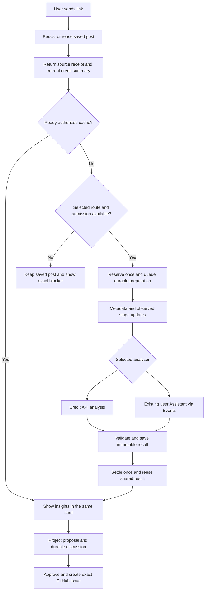

# Shared app and MCP UI implementation

Mode: implementation plan and acceptance ledger. Owner direction R153, November 4, 2026. Current accepted code remains website 189dc4f and backend 1843f1f; use CURRENT-STATE before execution. Planning/research does not change account balances or deploy a repair.

## Outcome

A user sends a link, immediately sees its saved receipt, then sees real metadata and backend progress in the same card. Completion replaces progress with retained insights and project actions. Available credits and any genuine blocker are visible without navigating through account settings. Expanding opens the familiar VibeScroll application layout inside the supported host.

Keep the website, fullscreen MCP application and compact card consistent by sharing presentation, controllers and contracts. Website sessions and MCP OAuth remain separate transports. Saved data, personal/team access, current shared versions and unknown holds remain authoritative.

## Consolidated scope

This plan is the next execution entry point for the overlapping UI/MCP requests. Older dated deferrals do not disable the later reactivated compact UI. Existing acceptance receipts remain valid within their stated limits.

| Existing plan                                                                                                                                       | Work carried into this plan                                                                                                                  |
| --------------------------------------------------------------------------------------------------------------------------------------------------- | -------------------------------------------------------------------------------------------------------------------------------------------- |
| [Simple setup and closed-loop proposals](SIMPLE-SETUP-AND-CLOSED-LOOP-PROPOSALS.md)                                                                 | Reused website/ChatGPT components, route-specific setup, ordinary permissions, retained results, same durable proposals.                     |
| [Chat-first demo](CHAT-FIRST-DEMO.md)                                                                                                               | ChatGPT/Codex reasoning with MCP data and persisted follow-up, alongside the credit route.                                                   |
| [One Cloud assistant per user](ONE-CLOUD-ASSISTANT-PER-USER.md)                                                                                     | Accurate connection versus monitor status, existing assistant reuse and supported setup only.                                                |
| [MCP flow implementation](MCP-FLOWS-IMPLEMENTATION.md)                                                                                              | Existing tools, safe errors, continuation, exact proposal/issue writes and feedback. Extend contracts instead of creating overlapping tools. |
| [Context retrieval](CONTEXT-RETRIEVAL-IMPLEMENTATION.md)                                                                                            | Workspace-local discovery, complete selected post context, shared grant references, bounded pages and native image reads.                    |
| [Home and plan review](../design/HOME-FEED-AND-PLAN-REVIEW.md)                                                                                      | Approved feed geometry, expandable insights, all-post proposal context, inline discussion, one Approve & create issue action.                |
| [Assistant elements](../design/ASSISTANT-ELEMENTS-AND-PROJECT-FIT.md) and [catalogue review](../design/ASSISTANT-UI-CATALOGUE-REVIEW-2026-10-30.md) | Real job stages, errors, credit meter, fit and proposal presentation.                                                                        |
| [Prepared MCP analysis](../operations/PREPARED-ANALYSIS-MCP.md) and [widget runbook](../operations/mcp-widget.md)                                   | Existing downloader/ASR/frame pipeline, both supported executors, versioned resources and host acceptance.                                   |
| [Posts, catalog and teams](POST-SUBSCRIPTIONS-CATALOG-AND-TEAMS.md) and [credit policy](PRO-PRICING-AND-CREDITS.md)                                 | Requested-post associations, explicit full-catalog access, each member's personal funding, exact reservation/settlement.                     |
| [Onboarding](ONBOARDING-IMPLEMENTATION.md)                                                                                                          | Shared components and connection status; preserve the approved quiz and payment flow. No new onboarding redesign.                            |

[Research and architecture comparison](../design/MCP-UI-RESEARCH-2026-11-04.md) records fetched sources, licenses, star counts and rejected alternatives.

## Confirmed incident and owner decision

Read-only production checks distinguish the account's available legacy test credits from an exhausted separate ten-attempt processing pilot. Failed attempts count toward that pilot. Its refusal occurs before the credit reservation. The referenced Reel did not receive a confirmed Save or analysis receipt. Actual private wallet, configuration and bounded counter receipts stay outside Git.

Full-catalog entitlement and its toggle are enabled for the owner. Choosing a catalog-named service workspace in widget_browse does not browse that catalog. The UI currently fails to express this distinction.

The owner approves a recurring 300-credit monthly admin allowance and generous hourly/daily limits. This is an explicit admin entitlement, not a fabricated Stripe subscription. Preserve existing pools, settlements and unknown reservations. An initial new admin pool may coexist with unexpired legacy credits; show that honestly. Proposed period: UTC calendar month, displayed in the user's timezone. Grant each period once, on eligible account use or the existing maintenance path; missed periods do not accumulate without bound. A monthly grant is not authority to buy provider funding. Credit reads remain read-only. Persist period refresh through an idempotent authorized mutation or existing maintenance, never an implicit write inside a query; initial activation records an actual admin grant before displaying it as available.

Replace the owner's lifetime ten-attempt pilot with bounded rate limits and the existing monetary provider reserve. Proposed owner limits are 20 starts/hour and 100/day, with existing two-job concurrency and ten-minute source bound where supported. Previous owner approvals already requested generous rate limits. Final configured limits must reflect current finite provider funding; no provider purchase, top-up, paid AI fallback or silent policy expansion. Keep consumed attempt history intact. Admin credits never bypass source, model, provider, unknown-work or spending checks.

## Product behavior

### Inline conversation card

Show a source thumbnail/placeholder, concise title, real state, credit summary and one primary action. Expand reveals observed stages, elapsed time and failure details. Main states are saving, saved, queued, preparing, waiting for assistant, analyzing, validating, ready, needs attention and unknown. A blocked job is not a running job.

Display the submitted link immediately as unverified input. Show authoritative title/creator/thumbnail as metadata arrives. Acknowledge Saved only after persistence. Keep the same card through completion, then offer insights, Apply to project and Open full view. Put evidence, versions, technical settings and advanced actions behind the existing drawer/menu.

The header shows personal available credits when the caller has the ordinary processing scope. Quote shows maximum required credits. Running work shows its held maximum; completion shows actual charged credits and current available balance. Unknown usage remains pending. A library-only connection can still read posts; absent financial scope is unavailable, never zero.

### Search discovery and synthesis

R154 adds an insight-first discovery view. While a bounded search is running, show one focused research canvas. Actual returned sources appear as small nodes and connect to their retained insight matches. Shared-topic groupings can appear only when the returned categories/terms support them. Source-to-insight edges are citation relationships; topic/project associations remain separately labeled. Never draw an invented knowledge graph or imply an unevaluated semantic relationship.

On completion, settle into a compact list of matching insights or patterns, with the source count and citations available on demand. Do not make raw post tiles the primary search output. Exact post requests still open the full retained post. The initial view contains at most a few source nodes and insight groups; larger graphs belong in expanded Explore, not inside the inline card.

Extend the existing search tool's UI-resource metadata and renderer to consume its initial tool input/result. Before any result arrives, use an abstract activity indicator with no fabricated source names or counts. Consume each real returned page immediately. Do not run a duplicate widget query while the host's initial tool call is pending, and do not delay cached results to complete an animation. A batch may reveal with a short transition; individual source arrival is not claimed when the backend returned one page.

The shared discovery controller handles accepted input, received page, deduplicated source/insight references, current categories, continuation, partial coverage, completion and failure. Old replies cannot enter a new query/workspace. Keys include current profile/grant and source/version references; cancellation removes superseded observers. Preserve authoritative coverage and both cursor/offset paths. “Partial results” remains distinct from “Search complete.”

Use the existing scoped ranked lexical search first. This UI does not implement embeddings, broader catalog access or synthesis inference. A larger synthesis is an explicit chat/model action over returned evidence. Begin with one query and its continuation. Combining arbitrary tool calls into one persistent host card needs verified host support; do not invent a widget-session API.

Use SVG for a few meaningful connections, CSS for basic state feedback and Motion/Motion Primitives only for layout continuity or interruptible expansion. Three-source nodes do not require a graph engine. Reduced motion presents the same real counts, citations and results without moving lines. Screen readers receive concise batch/status updates and a usable result list.

Official inline guidance limits primary actions to two, avoids nested scrolling/tabs/deep navigation, and keeps the native ChatGPT composer available. Ready cards offer View insights and a secondary Sources action; detailed browsing and proposal discussion move into fullscreen. Keep the proposal-scoped discussion there and avoid adding a second global chat composer.

A local Connected/Quiet replay study uses three actual authorized search results. It verifies desktop/mobile themes, 320px wrapping, reduced motion, native source-dialog opening and Escape. It is a private local preview, not a live search stream or actual ChatGPT host acceptance. No credit or model job is started.

### Fullscreen application

Use the website's content frame, design tokens, post/insight/proposal components and responsive layout. Home is the default; expose Library/Explore and Work using the existing navigation concepts. Account/billing/security and unsupported advanced features open the real website. Preserve the requested content-first mobile layout and desktop three columns. Do not nest the complete website chrome inside ChatGPT's own chrome.

A workspace switch is a small secondary control. Resolve explicit source/route scope first, then current saved default, then an eligible personal workspace, then ask only if still ambiguous. Preserve an intentional team choice. Service/catalog organizations are not ordinary empty personal workspaces. Put eligible canonical catalog browsing in an explicit Catalog view, using its existing entitlement/toggle. Browsing never silently subscribes the user to all catalog posts.

### Processing and failure

Keep Save and processing admission recoverable. A known credit, capacity, unsupported-route or provider-funding refusal preserves the link where saving itself is allowed. Return saved=true, source_id, analysis_started=false and an actionable reason. Counter/reservation writes for a refused start remain atomic and unconsumed. An unknown dispatch is reconciled using its original key, never retried as new work.

Do not silently switch from the user's selected subscription route to paid API analysis. Fresh server preparation can use credits even when reasoning uses ChatGPT. Cached retained evidence and cached analysis keep their existing zero-work semantics. Chat text and UI use the same receipt fields, so neither reports a guessed balance, fake percent or invented ETA.

## Flow



## Architecture sketch

Caller usage precedes extraction:

```tsx
<ApplicationScene model={useApplicationController(webRuntime, route)} platform={webPlatform} />
<ApplicationScene model={useApplicationController(mcpRuntime, route)} platform={mcpPlatform} />
<InlinePostCard model={usePostController(mcpRuntime, receipt)} onExpand={mcpPlatform.expand} />
```

The first migration can keep thin separate entry shells. They must share these contracts and controllers before extracting the complete scene.

```ts
type ProcessingAccountSummary = {
  available: number;
  held: number;
  expiredHeld: number;
  observedAt: number;
  nextExpiry: number | null;
  allowanceKind: "paid" | "admin" | "legacy";
  admission: {
    allowed: boolean;
    reason: string | null;
    retryAt: number | null;
  };
};
type SavedPostReceipt = {
  saved: boolean;
  sourceId: string | null;
  profileId: string;
  analysisStarted: boolean;
  job: JobView | null;
  account: ProcessingAccountSummary | null;
  nextAction: SafeAction;
};
type ApplicationBootstrap = {
  workspaces: WorkspaceSummary[];
  selectedWorkspace: WorkspaceRef | null;
  capabilities: CapabilitySummary;
  initial: BoundedView | null;
};
interface ApplicationRuntime {
  bootstrap(route: AppRoute): Promise<ApplicationBootstrap>;
  readPage(
    ref: CollectionRef,
    continuation: Continuation | null,
  ): Promise<BoundedPage>;
  readPost(ref: PostRef): Promise<PostView>;
  readProcessingAccount(): Promise<ProcessingAccountSummary>;
  observeJob(ref: JobRef, accept: (view: JobView) => void): () => void;
  commands: AuthorizedCommands;
}
```

Use semantic operations, not a public arbitrary call(name, any) interface. Sketch fields are design contracts; final validators bind exact current source/version/grant identities. Quote, reserved and settled amounts remain separate integers; monetary estimates keep precise intermediates.

Proposed module ownership:

- Extend existing packages/widget and packages/contracts for compatible bootstrap/receipt contracts. Preserve old resource/data versions and headless defaults.
- Extract only needed transport-independent components/controllers into packages/ui or a focused shared application module. Avoid a parallel library of one-line wrappers.
- Website adapter owns Next navigation/images, WorkOS and existing Convex subscriptions.
- MCP adapter owns the supported Apps bridge, OAuth tool calls, host navigation, frame delivery and visible polling.
- Convex owns current authority, selected defaults, catalog eligibility, durable jobs, personal wallets, admin grants and exact settlement.

Extend existing widget_profiles/widget_state into one compatible bootstrap path; consume its initial snapshot instead of immediately rediscovering via get_profile. Project context loads only when a project action needs it. Add one small get_processing_account read if existing tool outputs cannot expose the balance independently. It returns only the requesting person's processing summary, under the existing analysis:request scope, without invoices, team-owner balances or transactions. Existing connected processing clients should not need a new OAuth app or broader scopes. Knowledge-only rendering remains supported without that summary.

Extend save/start/status receipts and error schemas with actual saved outcome, correlation ID, quota dimension, retry/reset where known, maximum/charged credits and balance observation time. Normal admission refusal returns a rich receipt; real authentication failures retain the supported OAuth challenge. Avoid echoing the same financial payload in every transcript/frame fetch.

## Observation and performance

The website keeps native Convex subscriptions. The widget consumes its initial tool result immediately and uses supported MCP status reads after acknowledgement. Start at a 2-second visible cadence for a newly active card, back off to 5 seconds, and stop or suspend while hidden, terminal or out of its observation window. Resume with one current read on visibility/reopen. Keep one request in flight, cancel stale selection work and deduplicate observers for the same source/job.

A visible timeout says updates paused and offers Refresh/Open; it does not stop the backend job or infer failure. A ready incumbent plus pending reanalysis still observes the new attempt. Final detail is fetched once per changed analysis version; do not repeatedly return transcript and screenshots during polling. Metadata pages load first, selected detail and limited neighbors on demand. Preserve both cursor and explicit-source offset continuation, coverage and empty-intermediate-page behavior.

Do not add direct iframe database credentials, a second paid realtime service or a second AI chat backend for these states. Notifications are an optimization only after the actual host contract is verified. Measure UI time separately from host startup, server queue, preparation, reasoning and publication.

## Ordered implementation and acceptance

| Phase                                  | Changes                                                                                                                                                                                | Required evidence                                                                                                                                                                           |
| -------------------------------------- | -------------------------------------------------------------------------------------------------------------------------------------------------------------------------------------- | ------------------------------------------------------------------------------------------------------------------------------------------------------------------------------------------- |
| 0. Ground and plan                     | Reproduce referenced refusal, read real balance/counters/catalog status, audit entrypoints and compare architectures/repos                                                             | Completed read-only; actual desktop blank-frame cause remains unproved. Private account receipts retained.                                                                                  |
| 1. Owner allowance and honest receipts | Idempotent monthly admin grant, generous finite owner rates, monetary admission, separate credit/capacity errors, preserve Save after known admission refusal, small self-account read | Isolated month boundary/replay/concurrent grant/expiry tests; distinct credit/rate/provider failures; no fake Stripe records or released unknown holds. First bounded backend checkpoint.   |
| 2. Bootstrap and correct collections   | Consume initial snapshot, current default resolution, knowledge-only startup, explicit catalog view, cursor/offset/coverage and accurate empty states                                  | Multi-workspace/default/team/catalog, no-full-catalog-entitlement and revoked-source tests. No extra project-context read for a plain library.                                              |
| 3. Shared progress and inline card     | Extract source progress/error/credit presentation; show actual metadata, stages and final result in same card; rich blocked receipt                                                    | Observed state matrix, ready+reanalysis, hidden/reopen, stale replies, offline/timeout, duplicate commands and reduced-motion checks. Website and actual ChatGPT inline checkpoint.         |
| 4. Shared fullscreen scene             | Extract content frame, Home/feed/reader, settings drawer and navigation behind adapters; expand preserves source and reading position                                                  | Same source/version/insights across website and fullscreen, desktop/mobile/light/dark/320px, keyboard/text-size and no horizontal overflow. Preserve Library Tree/Folders.                  |
| 5. Proposal continuity                 | Reuse current proposal artifact, all-post context, discussion, generation and single approval/issue flow in expanded UI                                                                | Same durable proposal/version in chat and app; drafts survive collapse/reload; exact issue replay and no duplicate AI charge. No new issue without exact approval.                          |
| 6. Host and production acceptance      | Versioned resources, official bridge harness, actual desktop/mobile host, old cards, explicit failures, both routes and cache controls                                                 | Full checks and exact CI, compatible no-scan release, canonical website and actual host receipts. One bounded permitted canary per route only under current funding; cached controls first. |
| 7. Closeout                            | Public MCP docs/screenshots, request ledger, failure lessons, operator limits and honest production report                                                                             | Mark implemented, deployed and host-accepted separately. Preserve remaining host/mobile limitations.                                                                                        |

Phase 1, Phase 2 and processing-card Phase 3a form the first useful release. Search-discovery Phase 3b follows as a focused improvement; it does not delay the owner allowance or processing repair. Do not make its quota/balance/workspace repair wait for the full scene extraction. Later phases publish coherent accepted improvements within actual funding/provider limits. Documentation-only updates do not build the website.

## Test matrix

Use production-shaped, isolated transport fixtures for credit versus quota refusals, source-save rollback prevention, never-confirmed Save, ready cache, reanalysis while ready, two concurrent users requesting a canonical post and same-key retries. Assert one producer/charge, current account boundaries and unchanged incumbent evidence. Keep failed/unknown history.

Protocol tests cover initial input before/after host approval, empty initial payload, tool result before bridge readiness, reconnect, stale resource hash, unsupported fullscreen, permission-specific reads and surfaced safe errors. Use the existing official MCP Apps SDK harness before considering another test dependency.

Browser checks cover desktop 1440px, mobile 390px and 320px, both themes, host safe areas, reduced motion, keyboard and 200% text. Check actual permitted thumbnail/screenshot delivery under the configured resource CSP; Next relative URLs and blocked remote images must not produce blank posters. A mocked host is not final ChatGPT acceptance. Desktop browser mobile emulation is not a physical-phone result; request the owner's phone check for the latter.

Production acceptance begins with reads and zero-work cached posts. It proves current personal balance, actual rate/funding status, correct default workspace, explicit catalog access, old shared-post full reads, resumed progress, and same final immutable version. New paid/inference work requires available existing envelope. No real payment, provider purchase, new plugin, whole-library export or copied OAuth credential is part of this scope.

## Execution checklist

- [x] Diagnose actual wallet versus exhausted pilot and inspect current catalog access.
- [x] Trace active entrypoints, grants, bootstrap, progress and financial omissions.
- [x] Research primary documentation and repositories above 1,000 stars.
- [x] Compare architectures, obtain independent review and record synthesis.
- [x] Capture owner approval for 300 monthly admin credits and generous finite rates.
- [x] Implement and publish Phase 1 within actual funding.
- [x] Implement and publish Phase 2 and processing-card Phase 3a. Actual inline host acceptance remains in Phase6.
- [x] Implement insight-first search discovery Phase 3b from actual returned pages and citations. Published e51429d; actual ChatGPT/mobile acceptance remains in Phase6.
- [x] Implement shared fullscreen and proposal continuity. Built official-bridge acceptance and publication are recorded separately below.
- [ ] Finish actual host matrix, public docs and final production acceptance.

## Outside this change

Semantic embeddings, a local runner, unsupported hosted ChatGPT-login inference, community/model rankings, mascot, Stripe offer redesign and a new website visual redesign remain in their existing later plans. Preserve the approved visual references. This work makes the existing useful flows consistent and observable.

## November5 execution checkpoint

R155 approves implementation and the Connected prototype. The first local checkpoint adds an exact-account 300-credit UTC-month grant with idempotent renewal, 20/hour and 100/day admin processing limits, unchanged legacy pilot history and monetary admission. No Stripe subscription or tier is fabricated. Existing pools and expired unknown reservations remain intact.

Known admission refusal runs in a nested Convex mutation. Its credit writes roll back while the parent retains the saved link and a safe blocked receipt. Unexpected or unknown dispatch failures still stop without an automatic retry. A minimal processing-account tool and optional Save/status account receipts use current analysis permission and expose no invoices or team-owner balance.

Knowledge-only widget bootstrap selects the current app default without reading project context, excludes service workspaces, and exposes separately entitled catalog metadata, selected post context and native verified frames. Connected discovery uses actual returned source/insight references. Local checks, publication and actual host acceptance are recorded separately. This paragraph records the initial local checkpoint; the production section below supersedes its deployment state.

## Production and remaining acceptance, November5

The earlier dispatch checkpoint used backend4b66616 and website e51429d. The exact admin monthly grant and financial preservation passed actual read-back. The first canary revealed an entitlement mismatch at the dispatch barrier; the correction and its revoked-authority test pass. Its zero-dispatch/stopped proof permits exact reconciliation without touching old unknown work. The final b064887 publication below supersedes those serving commits.

The next fresh native run completed and automatically published4 insights and8 verified frames. A retained-evidence Muse control produced6 insights without another preparation pass. They settled1 credit each. The previous shared recommendation stayed selected. Two fresh preparation tests are now used; do not launch another fresh pass from this approval. The unused verification allowance funded the retained API control within the same USD0.90 envelope; engineering holds remain.

Phase4/5 is implemented and published at b064887. It shares the website's feed and proposal artifact through thin platform adapters, using current proposal records, durable discussion, scoped quote/start and explicit issue approval, plus one current context/JPEG metadata load. Canonical backend stages drive polling, and valid shared waits remain observable. Exact CI,17 publication guards,20 final built official-bridge cases,13 staged/13 canonical cases and authenticated post/Home/proposal reads pass. No schemas/indexes/components/auth/crons changed. [Production acceptance](../operations/evidence/launch-20261105-shared-ui-production.json).

Phase6's actual new ChatGPT iframe and physical-phone checks remain open, with a read-only owner check requested. Two hundred percent browser text zoom is unverified. Sent discussion is backend-durable. Generic opaque hosts preserve unsent discussion and pending keys only within the iframe lifetime; the optional documented private widget-state adapter additionally passes a synthetic full-reload fixture. This is not a universal host-persistence guarantee. Phase7 public developer documentation, request records and recovery lessons are updated; no new release is needed for operational closeout documents.
